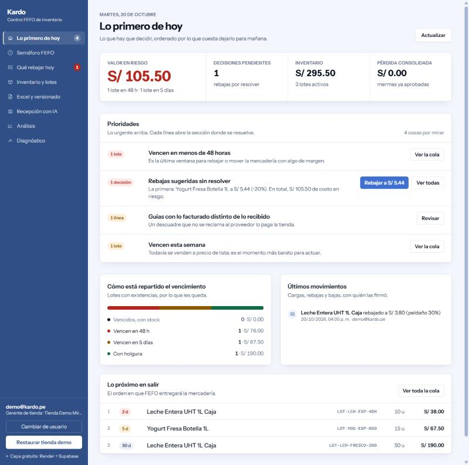
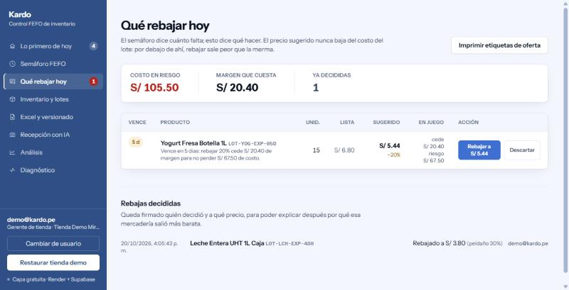
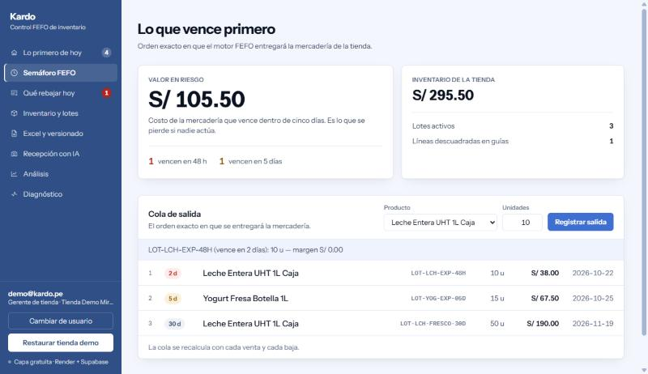

# 📦 Kardo

[](https://github.com/MrOdar/kardo/actions/workflows/ci.yml)
[](https://openjdk.org/)
[](https://spring.io/projects/spring-boot)
[-336791?style=flat&logo=postgresql)](https://www.postgresql.org/)
[](https://ai.google.dev/)

**Kardo evita que la mercadería se venza en el anaquel.**

Un minimarket pierde dinero por una razón aburrida: nadie sabe qué lote vence
primero. Kardo lleva ese control, vende siempre lo más próximo a caducar y
avisa —con un precio concreto— cuando todavía se puede recuperar la plata.

🔗 **Demo:** [kardo.onrender.com](https://kardo.onrender.com) · pulsa
**Restaurar tienda demo** y entras sin credenciales.
🔌 **API:** [`/swagger-ui.html`](https://kardo.onrender.com/swagger-ui.html) ·
inicia sesión con `demo@kardo.pe` / `kardo-demo-2026`, pega el token en
**Authorize** y pruébala desde ahí.



La aplicación no abre en una tabla: abre en la lista de lo que hay que decidir,
ordenada por lo que cuesta dejarlo para mañana.

---

## El mecanismo, en dos pantallas

Lo que otro sistema no copia diciendo lo mismo: **la recomendación llega hasta
el precio al que se vende.** No es un semáforo de colores, es un precio.



El yogur vence en cinco días. Rebajar un 20 % cede **S/ 20.40** de margen para
no perder **S/ 67.50** de costo, y el precio sugerido nunca baja del costo del
lote: por debajo de ahí, rebajar sale peor que la merma. Quien decide y a qué
precio queda firmado abajo.

Y entonces la caja cobra ese precio, no el de lista:



La salida de diez unidades se descontó de `LOT-LCH-EXP-48H` —el que caduca
primero, no el que entró último— y se cobró al precio rebajado de **S/ 3.80**.
Ese precio es el costo del lote: margen **S/ 0.00**, pero recupera los S/ 38.00
que la mercadería costó, en vez de convertirlos en una merma por el mismo
importe dos días después. La rebaja no es una etiqueta en el anaquel: cambia lo
que entra en caja, y el procedimiento PL/pgSQL que mueve el stock es quien lo
aplica.

---

## Cómo funciona

**La tienda sale del token, nunca de la petición.** Cada usuario pertenece a una
tienda y el backend ignora cualquier `storeId` que llegue en el cuerpo: es lo que
impide que un token de una tienda escriba en otra. No es una intención: hay **67
pruebas** que levantan la cadena de filtros real, con tokens firmados de verdad,
y comprueban quién entra, con qué rol y sobre qué tienda acaba escribiendo.

**Y se puede usar sin la demo.** Cualquiera da de alta su empresa desde la
pantalla de acceso: se crean la empresa, su primera tienda y la cuenta de
gerente en una sola transacción, y entra con el inventario vacío. Desde dentro,
ese gerente abre más tiendas y da de alta a su equipo; la empresa sale siempre
del token, así que nadie puede colocar un usuario en la tienda de otro.

**Una persona, varias tiendas, un rol en cada una.** La pertenencia vive en
`user_stores`, no en una columna del usuario: se puede ser gerente en un local y
operario en el de al lado. Cambiar de tienda no filtra la pantalla, **emite un
token nuevo** con esa tienda y ese rol, y sólo si existe la membresía. Que una
membresía no pueda cruzar empresas tampoco depende de que el servicio se acuerde
de comprobarlo: las dos claves foráneas de la tabla comparten la columna
`company_id`, así que la fila no se puede ni insertar.

**Lo que no puede cuadrar mal, lo impide la base.** El invariante
`current_qty + quarantined_qty <= initial_qty` es un `CHECK` del esquema, y la
venta FEFO es un procedimiento PL/pgSQL con bloqueo pesimista sobre los lotes.
Dos cajas vendiendo a la vez no pueden pasarse del stock aunque la aplicación
tuviera un error.

**Todo está pensado para 512 MB de RAM.** El Excel se procesa fila a fila
(`fastexcel`, nunca el DOM de POI), el multipart se vuelca a disco a partir de
64 KB, se usa `JdbcTemplate` en vez de JPA para no arrastrar un caché de primer
nivel, y el pool de conexiones vive en 5.

Y está medido, no supuesto:

| Filas | Archivo | Tiempo | Ritmo | Heap de la JVM | Memoria viva al terminar |
|---:|---:|---:|---:|---:|---:|
| 50.000 | 2,7 MB | 0,69 s | 73.000 filas/s | **64 MB** | 11 MB |
| 200.000 | 10,7 MB | 1,75 s | 114.000 filas/s | 128 MB | 11 MB |

Lo que sostiene el diseño no es la velocidad, es la última columna: **cuadruplicar
el archivo no cambia la memoria viva**, porque nunca está entero dentro. El límite
de heap es parte de la prueba —si la ingesta no fuera en streaming, 64 MB no darían
para 50.000 filas—, y los 128 MB del segundo caso los pide el generador del archivo
de prueba, que corre en la misma JVM, no la lectura. Se reproduce con:

```bash
mvn test -Pbench
```

**Quien hace algo queda firmado.** Cargas, correcciones, mermas, rebajas y
recepciones registran autor y momento. La huella SHA-256 del contenido es lo que
hace idempotente una carga reintentada tras un corte de red.

---

## Tres fallos que sólo salieron probando contra infraestructura real

Ninguno de estos lo habría encontrado leyendo el código, y ninguno hacía fallar
la suite. Están aquí porque son la parte del proyecto que más enseñó.

**1 · El instrumento que medía cero.** El diagnóstico de latencias cronometraba
las consultas sobrescribiendo `JdbcTemplate.execute(...)`. Spring delega
internamente en sobrecargas privadas, así que el método sobrescrito nunca se
llamaba: con la aplicación en marcha y la base trabajando, el contador decía
**0 consultas**. No lo detectó ninguna prueba —medir nada es consistente con no
hacer nada—, sino mirar el panel en vivo. Se rehízo envolviendo el `DataSource`
con un proxy sobre `Connection` y `Statement`, y ahora una prueba de integración
comprueba que la instrumentación está realmente conectada.

**2 · Un `?` que PostgreSQL no podía tipar.** La lista de mermas acepta un
`?status=` opcional. Sin filtro devolvía **500**: un parámetro suelto dentro de
un `IS NULL` deja a PostgreSQL sin saber de qué tipo es y rechaza la sentencia
entera. Llevaba tiempo así porque la interfaz sólo pedía `PENDING_APPROVAL`: el
caso por defecto del endpoint **no se había ejercitado nunca**. Corregido con
`?::varchar` y fijado en `WasteWorkflowIT`.

**3 · La rebaja que no llegaba a la caja.** El panel recomendaba un precio, el
gerente lo aprobaba, quedaba firmado… y la venta FEFO seguía cobrando el precio
de lista, porque el precio rebajado vivía en la tabla de decisiones y no en el
lote. El producto entero se apoyaba en un paso que no existía. Se añadió
`inventory_batches.markdown_price` con un `CHECK` que impide bajar del costo, y
el procedimiento de venta pasó a registrar `COALESCE(markdown_price,
retail_price)`.

**Un falso positivo, de propina:** el diagnóstico culpaba al pool de conexiones
para siempre, porque juzgaba por la espera **máxima** y abrir la primera
conexión contra Supabase cuesta segundos de TCP y TLS. En un proceso que no se
reinicia, ese pico de arranque no se olvidaba nunca. Ahora juzga por la mediana
y enseña el máximo como contexto.

> El porqué de cada decisión y el detalle de todos estos casos están en
> **[`docs/ARCHITECTURE_SPEC.md`](docs/ARCHITECTURE_SPEC.md)**.

---

## Con qué está hecho

| Capa | Tecnología | Por qué |
|---|---|---|
| Backend | **Java 21** · Spring Boot 3.3.4 | `JdbcTemplate` y no JPA: el control de memoria es explícito |
| Base de datos | **PostgreSQL 17** (Supabase) | Esquema 3NF, procedimientos PL/pgSQL, índice GIN `pg_trgm` para el matching de SKUs |
| Excel | **fastexcel** | Streaming de lectura y escritura, memoria constante |
| Visión | **Gemini Flash** | Extracción de guías con cadena de modelos de respaldo ante 429/503 |
| PDF | **PDFBox** | Apache-2.0: sin la pregunta de licencia que trae LGPL |
| Seguridad | **Spring Security 6** · JWT HS256 · BCrypt | Sin estado en servidor: el contenedor puede reiniciarse sin perder sesiones |
| Interfaz | **HTML + Tailwind (CDN) + JS sin framework** | Se sirve desde el mismo jar; no hay build de front |
| Contrato de la API | **springdoc-openapi** | Sale de los controladores, así que no hay documentación que mantener aparte del código |
| Despliegue | **Render** (backend) · **Supabase** (datos) | Capa gratuita, con heartbeat para que ninguno hiberne |

La aplicación abre en **lo primero de hoy**: las prioridades de la tienda
ordenadas por lo que cuesta dejarlas para mañana, cada una con el botón que
lleva adonde se resuelve. Detrás, siete secciones: semáforo FEFO, qué rebajar
hoy, inventario y lotes, Excel y versionado, recepción con IA, análisis y
diagnóstico de rendimiento. `Ctrl+K` abre el buscador global.

---

## Puesta en marcha

Requisitos: **JDK 21** y **Maven 3.9+**.

```bash
cp config/application-local.properties.example config/application-local.properties
# rellena la cadena de Supabase, el JWT_SECRET y la API key de Gemini
mvn spring-boot:run -Dspring-boot.run.profiles=local
```

Arranca en `http://localhost:8080`. Las credenciales viven en `config/`, que
Spring Boot lee en ejecución y **nunca entra en el jar**.

En producción se configuran por variables de entorno: `DATABASE_URL`,
`DATABASE_USERNAME`, `DATABASE_PASSWORD`, `JWT_SECRET`, `GEMINI_API_KEY` y
`CORS_ALLOWED_ORIGINS`.

### Base de datos

El esquema se aplica a mano (la aplicación no ejecuta migraciones). En orden:

```sql
CREATE EXTENSION IF NOT EXISTS pg_trgm;
-- luego sql/01 … sql/13, en orden numérico
```

`sql/01` empieza con `DROP TABLE … CASCADE`: **es destructivo**. Del `03` en
adelante son aditivos e idempotentes, así que se pueden reaplicar sin miedo.

### Pruebas

```bash
mvn verify    # 201 unitarias + 110 de integración
```

Las de integración levantan un **PostgreSQL 17 efímero** con Testcontainers y le
aplican los mismos scripts de `sql/` que se usan en Supabase: no hay un esquema
paralelo de pruebas. Sin Docker se saltan y el build sigue verde, así que
`mvn verify` es seguro en cualquier máquina; GitHub Actions las ejecuta de
verdad sobre Linux.

De las unitarias, **67 son de seguridad** (`EndpointSecurityTest`): 31 endpoints
que sin token responden 401, tokens caducados y firmados con otra clave, los
`@PreAuthorize` de cada rol, y el ataque que importa en un SaaS multi-inquilino
—token legítimo de una tienda, cuerpo apuntando a otra—, que debe cortarse antes
de escribir nada. Borrar un `@PreAuthorize` pone la suite en rojo.

El banco de rendimiento queda fuera del build a propósito —mide la máquina, no
una regla de negocio— y se pide aparte con `mvn test -Pbench`.

> **Windows + Docker Desktop reciente:** pueden saltarse en local aunque Docker
> esté instalado. Docker Desktop 29 responde al `/info` de clientes que no son su
> CLI con un `400` vacío y Testcontainers lo interpreta como "no hay Docker".
> WSL2 o un runner Linux son el camino corto.

---

## Mantenerlo en pie

| Qué | Cómo |
|---|---|
| Render despierto | `GET /api/v1/ping` desde UptimeRobot cada 5 min, sin tocar la base |
| Serie del riesgo | `@Scheduled` a las 23:50 de Lima: una foto diaria por tienda en `risk_snapshots` |
| Supabase activo | `@Scheduled` interno con un `SELECT 1` diario |
| ¿Quién va lento? | `GET /api/v1/ops/diagnostics` responde si es Gemini, Supabase o el pool |

El contrato de la API es público a propósito: describe qué endpoints existen,
que es lo que ya se lee en este repositorio, y no devuelve ni un dato de ninguna
tienda. Lo que protege esas rutas son los `@PreAuthorize` y el token, no el
desconocimiento de que existen. Aun así se apaga entero con
`SPRINGDOC_ENABLED=false`, y entonces las dos rutas responden 404.

El health check de Render debe apuntar a `/api/v1/ping`, no a
`/actuator/health`: ese último consulta la base y la despertaría en cada sonda.

---

## Licencia

[MIT](LICENSE). Úsalo, cámbialo o quédate con una parte; sólo conserva el aviso
de copyright.
