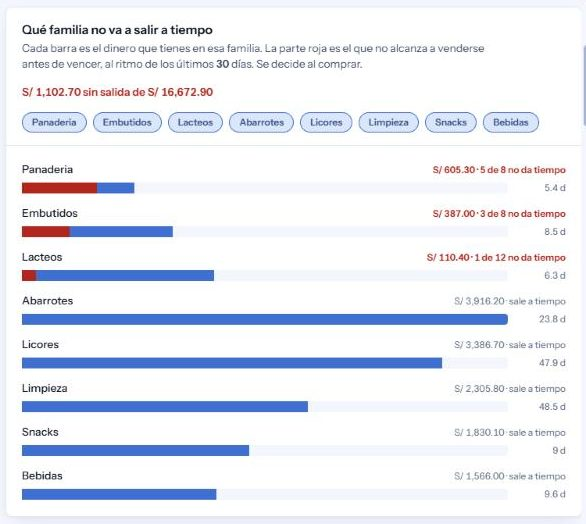
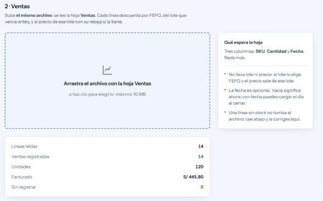
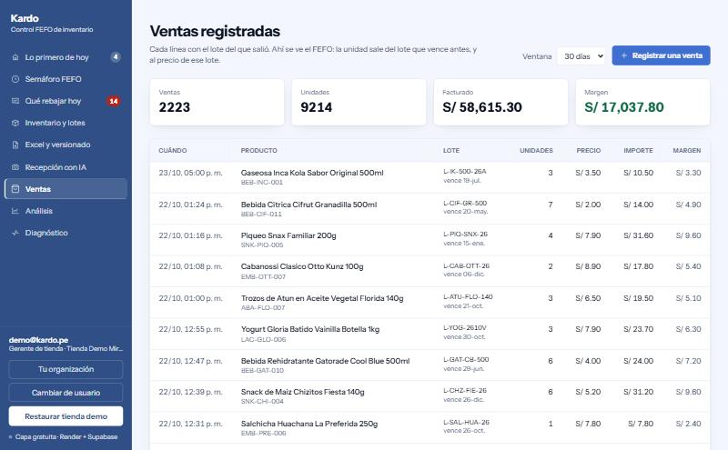
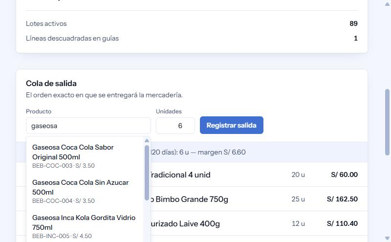

# 📦 Kardo

[](https://github.com/MrOdar/kardo/actions/workflows/ci.yml)
[](https://openjdk.org/)
[](https://spring.io/projects/spring-boot)
[-336791?style=flat&logo=postgresql)](https://www.postgresql.org/)
[](https://ai.google.dev/)

**Kardo evita que la mercadería se venza en el anaquel.**

Un minimarket pierde dinero por una razón aburrida: nadie sabe qué lote vence
primero. Kardo lleva ese control, vende siempre lo más próximo a caducar y
avisa —con un precio concreto— cuando todavía se puede recuperar la plata.

🔗 **Demo:** [kardo.onrender.com](https://kardo.onrender.com) · pulsa
**Restaurar tienda demo** y entras sin credenciales. La tienda se siembra con
**88 productos** de un minimarket peruano de verdad —lácteos, embutidos,
panadería, licores— con fechas relativas al día de hoy, así que el semáforo
abre con lotes venciendo en 48 horas y rebajas por decidir, no en verde.
🔌 **API:** [`/swagger-ui.html`](https://kardo.onrender.com/swagger-ui.html) ·
inicia sesión con `demo@kardo.pe` / `kardo-demo-2026`, pega el token en
**Authorize** y pruébala desde ahí.


La aplicación no abre en una tabla: abre en la lista de lo que hay que decidir,
ordenada por lo que cuesta dejarlo para mañana.

---

## El mecanismo, en dos pantallas

Lo que otro sistema no copia diciendo lo mismo: **la recomendación llega hasta
el precio al que se vende.** No es un semáforo de colores, es un precio.


El yogur vence en cinco días. Rebajar un 20 % cede **S/ 20.40** de margen para
no perder **S/ 67.50** de costo, y el precio sugerido nunca baja del costo del
lote: por debajo de ahí, rebajar sale peor que la merma. Quien decide y a qué
precio queda firmado abajo.

Y entonces la caja cobra ese precio, no el de lista:


La salida de diez unidades se descontó de `LOT-LCH-EXP-48H` —el que caduca
primero, no el que entró último— y se cobró al precio rebajado de **S/ 3.80**.
Ese precio es el costo del lote: margen **S/ 0.00**, pero recupera los S/ 38.00
que la mercadería costó, en vez de convertirlos en una merma por el mismo
importe dos días después. La rebaja no es una etiqueta en el anaquel: cambia lo
que entra en caja, y el procedimiento PL/pgSQL que mueve el stock es quien lo
aplica.

---

## Lo que el semáforo no ve

Las dos pantallas de arriba salvan mercadería que ya está en el anaquel. Esta
dice **qué no volver a comprar igual**, y encuentra plata que el semáforo deja
pasar por definición.

El semáforo mira cinco días. Un lote que vence en nueve y tarda doce en
venderse no entra en esa ventana —está "en verde"— y se pierde exactamente
igual. Para verlo hay que cruzar dos cifras que vivían separadas: lo que le
queda al lote y lo que tarda en salir. En la tienda demo, los embutidos:

| | Embutidos |
|---|---:|
| En riesgo, según el semáforo (≤ 5 días) | S/ 81.00 |
| **Sin salida**, al ritmo real de venta | **S/ 387.00** |

Casi cinco veces más, invisible hasta ahora.



Las tres familias que sangran son también las tres de menor valor: panadería y
embutidos son las dos barras más cortas del gráfico. El reparto completo:

| Familia | Valor | Sin salida | Cobertura |
|---|---:|---:|---:|
| Panadería | S/ 907.10 | **S/ 605.30** · 5 de 8 productos | ~5 d |
| Embutidos | S/ 1,214.80 | **S/ 387.00** · 3 de 8 | ~8 d |
| Lácteos | S/ 1,546.20 | **S/ 110.40** · 1 de 12 | ~6 d |
| Abarrotes | S/ 3,916.20 | — | ~24 d |
| Licores | S/ 3,386.70 | — | ~48 d |

De una tienda demo recién restaurada. La cobertura va aproximada a propósito:
se calcula sobre una ventana de 30 días que se desplaza, así que el decimal
cambia según el día de la semana en que se siembre. Las cifras de dinero no
se mueven.

Panadería es el **5 %** del inventario y el **55 %** de lo que se pierde.
Ordenado por valor aparecería la última y nadie la miraría; por eso el gráfico
ordena por lo que sangra, no por lo que vale.

Las familias se quitan y se ponen con un clic, y la escala y los totales se
rehacen con lo que queda: quitar abarrotes y licores —que no se vencen nunca—
deja comparar la mercadería fresca entre sí sin que la aplaste el volumen de la
seca. No hay ninguna librería de gráficos detrás: son barras con `div`, por la
misma razón que la CSP no admite `'unsafe-inline'` en `script-src`.

Un producto **sin ventas** no cuenta como perdido aunque venza mañana. No se
sabe a qué ritmo sale, y suponerle el peor caso inflaría la cifra justo en lo
que acaba de llegar. Esa regla está fijada en `InventoryInsightsIT`.

---

## De dónde salen las ventas

Todo lo anterior —la cobertura, el reparto por familias, el semáforo— se calcula
sobre `daily_sales`. Una tienda que no registra sus ventas tiene un sistema que
no puede decirle nada: sabe qué hay en el anaquel, pero no a qué ritmo sale, que
es la mitad que convierte un inventario en una decisión de compra.

Por eso la misma plantilla trae dos hojas:

| Hoja | Qué hace | Columnas |
|---|---|---|
| **Inventario** | Crea los lotes | SKU, producto, categoría, costo, precio, lote, vencimiento, cantidad |
| **Ventas** | Los descuenta por FEFO | **SKU, Cantidad, Fecha** |



**Las tres columnas que faltan son la parte interesante.** La hoja de ventas no
pide lote ni precio. El lote lo elige el motor FEFO —del más próximo a vencer al
más lejano— y el precio sale de ese lote, ya con su rebaja si la tiene.
Pedírselos a quien llena el Excel deshace las dos cosas que hace el producto:
una tienda que teclea el lote a mano acabará vendiendo del equivocado, y una que
teclea el precio registrará un margen que no es el que cobró la caja.

**La fecha es opcional, y por eso existe `sql/17`.** El procedimiento sellaba
siempre `CURRENT_TIMESTAMP`, que es lo correcto cuando la venta se teclea en la
caja. Con la carga por Excel deja de serlo: una tienda sube las ventas del día al
cerrar, o recupera una semana atrasada, y apilarlas todas en el momento de la
subida descuadra la ventana de 30 días sobre la que se calcula la rotación de
*todo* el catálogo. Celda vacía sigue significando "ahora".

### Dónde se ven después

Durante un tiempo esto fue un hueco de verdad: las ventas se registraban desde
la caja y desde el Excel, alimentaban la cobertura y el reparto por familias, y
**no había ninguna pantalla donde mirarlas**. `daily_sales` se escribía desde
tres sitios y se leía desde uno solo, y ahí como insumo. Se podían registrar 72
ventas y luego no encontrarlas.



La pestaña **Ventas** las muestra con el dato que ninguna otra pantalla puede
dar: **el lote del que salió cada una**. Eso es el FEFO fila a fila —se ve que
la unidad salió del que vencía antes— y es también donde se comprueba que el
precio cobrado fue el de ese lote, con su rebaja si la tenía, y no el del
catálogo. Una venta rebajada lleva su marca; un margen negativo sale en rojo,
porque una venta por debajo del costo del lote es exactamente lo que hay que
poder ver.

**El botón "Registrar una venta" no abre un formulario propio**: lleva al que ya
existe en el semáforo, junto a la cola de salida, porque allí se ve qué lotes
consumió la venta. Duplicarlo serían dos implementaciones del mismo gesto que se
desincronizan. Lo que faltaba era el camino desde esta pantalla, no la
funcionalidad.

Dos detalles que no se notan pero sostienen la pantalla:

* **Los totales no se deducen de la tabla.** Esa lista viene acotada, así que
  sumarla daría el total de lo que cabe en pantalla y no el de la ventana. Son
  dos consultas a propósito, y cuando no coinciden el pie lo dice: *"Se muestran
  las 100 más recientes de 2222"*. Dos cifras que se contradicen sin explicación
  son peores que una consulta de más.
* **El margen se calcula, no se guarda.** `unit_retail_price` y `lot_unit_cogs`
  ya están congelados en cada fila, así que la resta da siempre lo mismo.

### Las dos decisiones que costaron más que el código

**Una línea mala no se lleva por delante a las buenas.** En PostgreSQL un error
aborta la transacción entera: sin un savepoint por fila, la primera línea sin
stock haría fallar todas las de detrás con *current transaction is aborted*, y el
operario vería diez filas en cuarentena cuando sólo una estaba mal. Cada llamada
al procedimiento va en su propio savepoint (`BulkSaleRegistrar`). Para comprobar
que esa pieza carga de verdad se cambió `PROPAGATION_NESTED` por `REQUIRED` y
cinco pruebas fallaron con ese error exacto.

**Una carga de ventas no se puede revertir, y el sistema lo dice.** Revertir
inventario borra lotes que no habían pasado nada; deshacer una venta significa
devolver unidades a un lote que entretanto pudo agotarse, darse de baja por merma
o canjearse al proveedor. Sin una guarda explícita, la reversión *parecería*
funcionar: no encontraría lotes que borrar, marcaría la carga como revertida y
devolvería un éxito —y además liberaría la huella, de modo que volver a subir el
archivo registraría las ventas por segunda vez. Una venta mal registrada se
corrige como en una tienda de verdad: por el circuito de mermas o el de canjes,
que sí dejan rastro de quién decidió qué.

Lo que no entra vuelve a la pantalla con su motivo —*"Faltaron 96 unidades"*— y
se corrige ahí mismo. Lo que se reenvía son **las filas sueltas, nunca el
archivo**: un Excel con una línea arreglada tiene otra huella, pasaría la guarda
de duplicados y registraría otra vez todo lo que ya había entrado bien.

---


### Encontrar un producto, y añadir uno

El formulario de venta tenía un `<select>` con el catálogo entero. Con 91
productos eso obliga a recorrer la lista para encontrar "Inca Kola", y con el
catálogo de una tienda de verdad deja de ser usable.



Ahora se escribe y se filtra, por nombre, por SKU o por familia. Es un combobox
a mano y no un `<datalist>`: éste deja escribir cualquier cosa y obliga a
resolverla después, y su aspecto lo decide el navegador. El precio de hacerlo a
mano es el teclado, que un `<select>` traía de serie: flechas con vuelta por los
dos extremos, Enter para elegir, Escape para cerrar, y `aria-activedescendant`
para que un lector de pantalla anuncie la opción resaltada sin mover el foco.

**Lo que se ve es el nombre y lo que se envía es el SKU.** Son dos campos, no
uno. Si el formulario leyera el texto visible, el procedimiento recibiría
"Gaseosa Inca Kola..." como SKU; y reescribir sin elegir invalida la selección
anterior, porque si no, quien eligió Coca Cola, borró y escribió "Inca" acabaría
vendiendo Coca Cola con "Inca" a la vista.

**Y el catálogo ya crece sin pasar por Excel.** Había un hueco raro: añadir una
gaseosa de otra marca obligaba a armar un archivo. El botón *Añadir producto* de
la pestaña de inventario da de alta el producto y, si lleva unidades, su primer
lote —porque un producto sin lote no sale en el semáforo, no se puede vender y
no aparece en el análisis, así que darlo de alta solo dejaría la sensación de
que no pasó nada—.

Dos reglas que lo separan de la carga masiva:

* **Un SKU repetido se rechaza con 409, no se actualiza.** La ingesta por Excel
  hace `ON CONFLICT DO UPDATE`, y ahí es correcto: un archivo del proveedor trae
  el catálogo entero y se espera que actualice precios. Un alta manual es el
  gesto contrario, y pisar en silencio el precio de un producto existente es un
  error que nadie ve hasta que la caja cobra de menos. El mensaje nombra al que
  ya ocupa ese código.
* **Con unidades, la fecha de vencimiento es obligatoria.** El FEFO ordena por
  ella: un lote sin fecha sería invisible al motor y nunca saldría a la venta,
  que es peor que no crearlo porque el operario creería tener existencias.


**Y se puede corregir, no sólo crear.** Faltaba: cambiar un precio obligaba a
armar un Excel, que es justo el rodeo que el alta manual vino a quitar. El mismo
formulario hace las dos cosas —si el SKU que escribes ya existe, pasa a modo
corrección y se rellena solo—, así que no hace falta un segundo formulario ni un
selector de "qué producto quiero editar": el SKU ya es esa pregunta.

Tres reglas, y la segunda es la que sorprende:

* **Sólo el gerente.** Dar de alta es meter datos y lo hace cualquiera; cambiar
  un precio es cambiar lo que cobra la caja en cada venta futura, y a diferencia
  de una merma o un canje, aquí no hay nadie que lo resuelva después. Es la
  misma línea que separa declarar una merma de aprobarla.
* **El precio nuevo rige desde la próxima venta, también para los lotes que ya
  están en el anaquel** —el procedimiento lee el precio del catálogo salvo que
  el lote tenga rebaja propia—, pero **el costo nuevo no toca los lotes
  existentes**. Cada lote guarda el costo al que entró *su* mercadería, y eso es
  lo que ancla el margen de lo ya recibido: si corregir la ficha reescribiera el
  costo de lo comprado hace tres meses, el margen histórico cambiaría
  retroactivamente y el análisis dejaría de poder compararse consigo mismo. La
  interfaz lo avisa y dice cuántos lotes conservan el suyo.
* **El SKU no se corrige.** Es la clave con la que la ingesta por Excel reconoce
  el producto: cambiarlo haría que la próxima carga creara uno nuevo al lado y
  el histórico quedara repartido entre dos fichas sin que nadie lo note.

**El libro de ventas pagina.** Con 2.200 ventas en treinta días, el tope de 100
dejaba las más viejas fuera de alcance, y ensanchar la ventana no servía porque
el tope seguía cortando por arriba. Ahora hay un botón que trae las siguientes.

## Cómo funciona

**La tienda sale del token, nunca de la petición.** Cada usuario pertenece a una
tienda y el backend ignora cualquier `storeId` que llegue en el cuerpo: es lo que
impide que un token de una tienda escriba en otra. No es una intención: hay **78
pruebas** que levantan la cadena de filtros real, con tokens firmados de verdad,
y comprueban quién entra, con qué rol y sobre qué tienda acaba escribiendo.

**Y se puede usar sin la demo.** Cualquiera da de alta su empresa desde la
pantalla de acceso: se crean la empresa, su primera tienda y la cuenta de
gerente en una sola transacción, y entra con el inventario vacío. Desde dentro,
ese gerente abre más tiendas y da de alta a su equipo; la empresa sale siempre
del token, así que nadie puede colocar un usuario en la tienda de otro.

**Una persona, varias tiendas, un rol en cada una.** La pertenencia vive en
`user_stores`, no en una columna del usuario: se puede ser gerente en un local y
operario en el de al lado. Cambiar de tienda no filtra la pantalla, **emite un
token nuevo** con esa tienda y ese rol, y sólo si existe la membresía. Que una
membresía no pueda cruzar empresas tampoco depende de que el servicio se acuerde
de comprobarlo: las dos claves foráneas de la tabla comparten la columna
`company_id`, así que la fila no se puede ni insertar.

**Lo que no puede cuadrar mal, lo impide la base.** El invariante
`current_qty + quarantined_qty <= initial_qty` es un `CHECK` del esquema, y la
venta FEFO es un procedimiento PL/pgSQL con bloqueo pesimista sobre los lotes.
Dos cajas vendiendo a la vez no pueden pasarse del stock aunque la aplicación
tuviera un error.

**Todo está pensado para 512 MB de RAM.** El Excel se procesa fila a fila
(`fastexcel`, nunca el DOM de POI), el multipart se vuelca a disco a partir de
64 KB, se usa `JdbcTemplate` en vez de JPA para no arrastrar un caché de primer
nivel, y el pool de conexiones vive en 5.

**Y se puede comprobar sin traer nada.** La pestaña *Excel y versionado* ofrece
un `.xlsx` de ejemplo con esos mismos 88 productos. Súbelo y entran 88 lotes;
súbelo otra vez y responde **409**, porque la huella del contenido ya está
registrada. Son las dos mitades de la misma regla, en dos clics. La carga que
la demo siembra lleva a propósito otro nombre y otra huella: si compartieran
contenido, el archivo de ejemplo se rechazaría la *primera* vez y no habría
nada que enseñar.

Y está medido, no supuesto:

| Filas | Archivo | Tiempo | Ritmo | Heap de la JVM | Memoria viva al terminar |
|---:|---:|---:|---:|---:|---:|
| 50.000 | 2,7 MB | 0,69 s | 73.000 filas/s | **64 MB** | 11 MB |
| 200.000 | 10,7 MB | 1,75 s | 114.000 filas/s | 128 MB | 11 MB |

Lo que sostiene el diseño no es la velocidad, es la última columna: **cuadruplicar
el archivo no cambia la memoria viva**, porque nunca está entero dentro. El límite
de heap es parte de la prueba —si la ingesta no fuera en streaming, 64 MB no darían
para 50.000 filas—, y los 128 MB del segundo caso los pide el generador del archivo
de prueba, que corre en la misma JVM, no la lectura. Se reproduce con:

```bash
mvn test -Pbench
```

**Antes de perder el costo, se intenta recuperarlo.** Los distribuidores
grandes canjean la mercadería próxima a vencer si se avisa a tiempo, así que en
los lotes que llegaron con guía de remisión Kardo ofrece devolverla **antes** de
proponer la merma: la tienda recupera el costo entero en vez de perderlo. No es
un motivo más de merma, es otra tabla, porque el signo del dinero es el
contrario: `waste_log.total_loss_amount` es una columna generada y todo lo que
entra ahí es pérdida por definición. Si el proveedor no lo acepta, la mercadería
vuelve al stock y el semáforo la empuja al circuito de mermas, que ya existe.

**Quien hace algo queda firmado.** Cargas, correcciones, mermas, rebajas,
canjes y recepciones registran autor y momento. La huella SHA-256 del contenido
es lo que hace idempotente una carga reintentada tras un corte de red.

---

## Tres fallos que sólo salieron probando contra infraestructura real

Ninguno de estos lo habría encontrado leyendo el código, y ninguno hacía fallar
la suite. Están aquí porque son la parte del proyecto que más enseñó.

**1 · El instrumento que medía cero.** El diagnóstico de latencias cronometraba
las consultas sobrescribiendo `JdbcTemplate.execute(...)`. Spring delega
internamente en sobrecargas privadas, así que el método sobrescrito nunca se
llamaba: con la aplicación en marcha y la base trabajando, el contador decía
**0 consultas**. No lo detectó ninguna prueba —medir nada es consistente con no
hacer nada—, sino mirar el panel en vivo. Se rehízo envolviendo el `DataSource`
con un proxy sobre `Connection` y `Statement`, y ahora una prueba de integración
comprueba que la instrumentación está realmente conectada.

**2 · Un `?` que PostgreSQL no podía tipar.** La lista de mermas acepta un
`?status=` opcional. Sin filtro devolvía **500**: un parámetro suelto dentro de
un `IS NULL` deja a PostgreSQL sin saber de qué tipo es y rechaza la sentencia
entera. Llevaba tiempo así porque la interfaz sólo pedía `PENDING_APPROVAL`: el
caso por defecto del endpoint **no se había ejercitado nunca**. Corregido con
`?::varchar` y fijado en `WasteWorkflowIT`.

**3 · La rebaja que no llegaba a la caja.** El panel recomendaba un precio, el
gerente lo aprobaba, quedaba firmado… y la venta FEFO seguía cobrando el precio
de lista, porque el precio rebajado vivía en la tabla de decisiones y no en el
lote. El producto entero se apoyaba en un paso que no existía. Se añadió
`inventory_batches.markdown_price` con un `CHECK` que impide bajar del costo, y
el procedimiento de venta pasó a registrar `COALESCE(markdown_price,
retail_price)`.

**Un falso positivo, de propina:** el diagnóstico culpaba al pool de conexiones
para siempre, porque juzgaba por la espera **máxima** y abrir la primera
conexión contra Supabase cuesta segundos de TCP y TLS. En un proceso que no se
reinicia, ese pico de arranque no se olvidaba nunca. Ahora juzga por la mediana
y enseña el máximo como contexto.

> El porqué de cada decisión y el detalle de todos estos casos están en
> **[`docs/ARCHITECTURE_SPEC.md`](docs/ARCHITECTURE_SPEC.md)**.

---

## Con qué está hecho

| Capa | Tecnología | Por qué |
|---|---|---|
| Backend | **Java 21** · Spring Boot 4.1.2 | `JdbcTemplate` y no JPA: el control de memoria es explícito |
| Base de datos | **PostgreSQL 17** (Supabase) | Esquema 3NF, procedimientos PL/pgSQL, índice GIN `pg_trgm` para el matching de SKUs |
| Excel | **fastexcel** | Streaming de lectura y escritura, memoria constante |
| Visión | **Gemini Flash** | Extracción de guías con cadena de modelos de respaldo ante 429/503 |
| PDF | **PDFBox** | Apache-2.0: sin la pregunta de licencia que trae LGPL |
| Seguridad | **Spring Security 6** · JWT HS256 · BCrypt | Sin estado en servidor: el contenedor puede reiniciarse sin perder sesiones |
| Interfaz | **HTML + Tailwind (CDN) + JS sin framework** | Se sirve desde el mismo jar; no hay build de front. Node existe sólo para probarla: `vitest` carga el `index.html` y el `app.js` de verdad en jsdom |
| Contrato de la API | **springdoc-openapi** | Sale de los controladores, así que no hay documentación que mantener aparte del código |
| Despliegue | **Render** (backend) · **Supabase** (datos) | Capa gratuita, con heartbeat para que ninguno hiberne |

La aplicación abre en **lo primero de hoy**: las prioridades de la tienda
ordenadas por lo que cuesta dejarlas para mañana, cada una con el botón que
lleva adonde se resuelve. Detrás, ocho secciones: semáforo FEFO, qué rebajar
hoy, inventario y lotes, Excel y versionado, recepción con IA, ventas
registradas, análisis y diagnóstico de rendimiento. `Ctrl+K` abre el buscador global.

---

## Puesta en marcha

Requisitos: **JDK 21** y **Maven 3.9+**.

```bash
cp config/application-local.properties.example config/application-local.properties
# rellena la cadena de Supabase, el JWT_SECRET y la API key de Gemini
mvn spring-boot:run -Dspring-boot.run.profiles=local
```

Arranca en `http://localhost:8080`. Las credenciales viven en `config/`, que
Spring Boot lee en ejecución y **nunca entra en el jar**.

En producción se configuran por variables de entorno: `DATABASE_URL`,
`DATABASE_USERNAME`, `DATABASE_PASSWORD`, `JWT_SECRET`, `GEMINI_API_KEY` y
`CORS_ALLOWED_ORIGINS`.

### Base de datos

El esquema se aplica a mano (la aplicación no ejecuta migraciones). En orden:

```sql
CREATE EXTENSION IF NOT EXISTS pg_trgm;
-- luego sql/01 … sql/18, en orden numérico
```

`sql/01` empieza con `DROP TABLE … CASCADE`: **es destructivo**. Del `03` en
adelante son aditivos e idempotentes, así que se pueden reaplicar sin miedo.

### Pruebas

```bash
mvn verify    # 251 unitarias + 182 de integración
npm ci && npm test   # 32 de la SPA, en jsdom
```

Node hace además una cosa que no es probar: **compilar el CSS**. Tras tocar
`src/main/css/kardo.css` o `tailwind.config.js` hay que ejecutar `npm run css`
y commitear `static/kardo.css`, porque Render no tiene Node y el jar debe
llevar la hoja ya hecha. Se versiona a propósito, y el CI la reconstruye y
falla si lo versionado no coincide —si no, una clase nueva en `app.js` no
rompería nada: sólo saldría un elemento sin estilo—. Mientras se diseña,
`npm run css:watch`.

Las de integración levantan un **PostgreSQL 17 efímero** con Testcontainers y le
aplican los mismos scripts de `sql/` que se usan en Supabase: no hay un esquema
paralelo de pruebas. Sin Docker se saltan y el build sigue verde, así que
`mvn verify` es seguro en cualquier máquina; GitHub Actions las ejecuta de
verdad sobre Linux.

De las unitarias, **91 son de seguridad** (`EndpointSecurityTest`): 40 endpoints
que sin token responden 401, tokens caducados y firmados con otra clave, los
`@PreAuthorize` de cada rol, y el ataque que importa en un SaaS multi-inquilino
—token legítimo de una tienda, cuerpo apuntando a otra—, que debe cortarse antes
de escribir nada. Borrar un `@PreAuthorize` pone la suite en rojo.

`DemoResetIT` cubre lo que más se mira y menos se probaba: el procedimiento que
siembra la tienda demo. No lo llama en frío —así siempre pasaría— sino después
de **usarla**: vende, declara una merma y un canje, y recién entonces restaura.
`daily_sales`, `waste_log` y `supplier_returns` apuntan al lote con
`ON DELETE RESTRICT`, de modo que el borrado choca con la clave foránea en
cuanto alguien toca la demo. Ya pasó una vez, y se descubrió a mano.

`SpaContractTest` cubre un caso distinto: que `script-src` siga siendo
exactamente `'self'`. Durante un tiempo tuvo que ser más ancho —autorizaba el
dominio del CDN de Tailwind y, por su hash SHA-256, el bloque en línea que lo
configuraba—. Compilar el CSS dejó sin trabajo a las dos excepciones, así que
el jar es ahora el único origen de código de la página. Traer después las dos
tipografías a `static/fonts` cerró también `style-src` y `font-src`: **la
página no hace ni una petición fuera de su origen**, de modo que ni el aspecto
ni el funcionamiento dependen de que conteste un tercero. La prueba falla el
build si vuelve a aparecer un `<script>` en línea, un `<style>` o un `onclick=`:
nada de eso rompe en una prueba de servidor —el HTML se sirve tal cual—, lo
bloquea el navegador del operario, en producción y en silencio.

El banco de rendimiento queda fuera del build a propósito —mide la máquina, no
una regla de negocio— y se pide aparte con `mvn test -Pbench`.

> **Docker 29 y Testcontainers 1.x:** si las de integración se saltan aunque
> Docker esté corriendo, la causa no es Docker Desktop ni Windows. Docker 29
> subió la **API mínima de 1.24 a 1.44**, y el `docker-java` que trae
> Testcontainers 1.x negocia una anterior: el daemon responde `400` a `/info` y
> Testcontainers lo lee como "no hay Docker". Se arregla fijando la versión de
> la API, una línea en el *home* del usuario:
>
> ```bash
> echo "api.version=1.44" > ~/.docker-java.properties
> ```
>
> Con eso, `mvn verify` levanta los contenedores en Windows igual que en CI. El
> arreglo de fondo es subir a Testcontainers 2.x, que ya habla la API nueva;
> queda pendiente porque `spring-boot-testcontainers` espera la rama 1.x.

---

## Mantenerlo en pie

| Qué | Cómo |
|---|---|
| Render despierto | `GET /api/v1/ping` desde UptimeRobot cada 5 min, sin tocar la base |
| Serie del riesgo | `@Scheduled` a las 23:50 de Lima: una foto diaria por tienda en `risk_snapshots` |
| Supabase activo | `@Scheduled` interno con un `SELECT 1` diario |
| ¿Quién va lento? | `GET /api/v1/ops/diagnostics` responde si es Gemini, Supabase o el pool |

El contrato de la API es público a propósito: describe qué endpoints existen,
que es lo que ya se lee en este repositorio, y no devuelve ni un dato de ninguna
tienda. Lo que protege esas rutas son los `@PreAuthorize` y el token, no el
desconocimiento de que existen. Aun así se apaga entero con
`SPRINGDOC_ENABLED=false`, y entonces las dos rutas responden 404.

El health check de Render debe apuntar a `/api/v1/ping`, no a
`/actuator/health`: ese último consulta la base y la despertaría en cada sonda.

---

## Licencia

[MIT](LICENSE). Úsalo, cámbialo o quédate con una parte; sólo conserva el aviso
de copyright.
