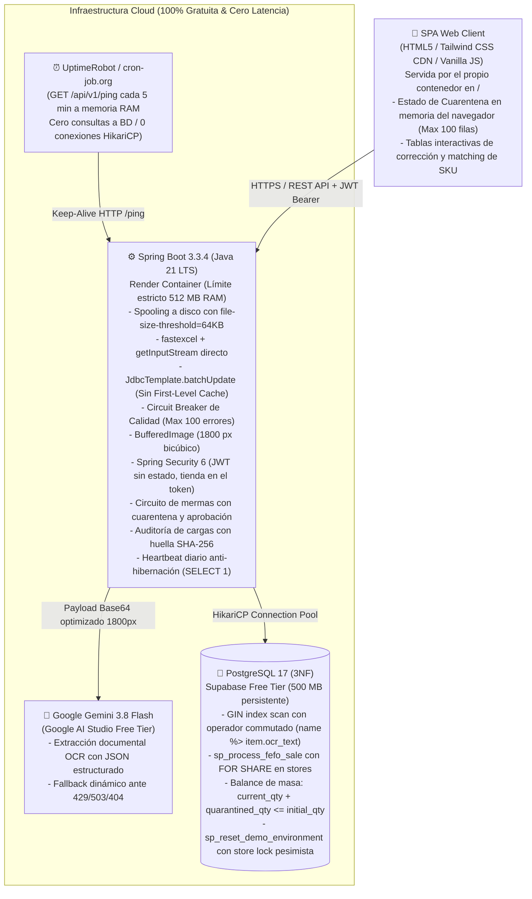
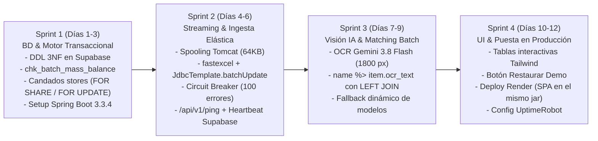

# 📋 Informe de Arquitectura Técnica: Kardo (v2.4)
## Plataforma SaaS B2B de Migración Inteligente, Conciliación Documental con Visión IA y Motor Transaccional FEFO (3NF)

---

### 1. Resumen Ejecutivo y Storytelling de Negocio
**Kardo** es una plataforma SaaS B2B diseñada para erradicar las ineficiencias críticas de inventario, los descuadres de recepción documental y las pérdidas por vencimiento en cadenas de retail de alta frecuencia, minimarkets y farmacias.

* **El Problema:** El 90% de los negocios de proximidad gestiona su stock en hojas de cálculo heterogéneas y transcribe manualmente facturas y guías de remisión impresas. Esto genera que más del 70% de las mermas monetarias se deban al vencimiento de perecibles (por falla en la rotación FEFO/PEPS) y a discrepancias no reclamadas frente al proveedor.
* **La Solución:** Un SaaS que ingesta archivos Excel masivos en streaming continuo (< 20 MB de RAM), procesa guías de remisión impresas mediante Visión Multimodal (Gemini 3.8 Flash) cruzándolas contra el catálogo relacional en 3NF, y ejecuta las salidas bajo estricto algoritmo transaccional FEFO con auditoría antifraude en PostgreSQL 17.

---

### 2. Diagrama de Arquitectura y Pila Tecnológica ($0 Costo / Producción 24/7)



#### Decisiones de Ingeniería Justificadas:
| Componente | Tecnología | Decisión de Arquitectura / Trade-off |
|---|---|---|
| **Core Runtime** | **Java 21 LTS + Spring Boot 3.3.4** | Tipado fuerte, Virtual Threads para concurrencia I/O y estándar corporativo bancario. |
| **Parser de Excel** | **`fastexcel` (dhatim) + `JdbcTemplate`** | **Evita OOM:** Streaming directo desde `file.getInputStream()` con spooling en `/tmp` fuera del Java Heap (`file-size-threshold=64KB`). Inserta mediante `JdbcTemplate.batchUpdate()` en micro-lotes de 500 filas, esquivando el First-Level Cache de Hibernate. |
| **Persistencia** | **PostgreSQL 17 en Supabase** | 500 MB persistentes que no consumen horas de cómputo activo como Neon, con índice `GIN` para `word_similarity` y procedimientos transaccionales. |
| **Keep-Alive Híbrido** | **UptimeRobot (5 min) + Heartbeat diario** | `/api/v1/ping` en RAM cada 5 min mantiene vivo Render; un `@Scheduled` diario ejecuta `SELECT 1` para evitar la pausa por 7 días de inactividad de Supabase. |
| **IA & OCR** | **Gemini 3.8 Flash (1800 px bicúbico)** | Preserva la legibilidad de letras pequeñas en facturas A4 produciendo un payload ligero (~350 KB) con autodescubrimiento y conmutación de modelos. |
| **Identidad** | **Spring Security 6 + JWT HS256 + BCrypt** | La tienda es un atributo del usuario y viaja firmada dentro del token: ningún endpoint acepta un `store_id` del cliente. Roles OPERATOR y MANAGER aplicados con `@PreAuthorize`. |
| **Entrega de la SPA** | **Recursos estáticos del propio jar** | Un único despliegue en Render en lugar de backend y frontend separados: desaparecen el CORS entre dominios, el segundo pipeline y la ventana en que una versión del front habla con otra del back. |
| **Idempotencia de cargas** | **SHA-256 del contenido + índice único parcial** | Reintentar una carga tras un corte de red es el error más común del operario; la huella del contenido lo detecta aunque el archivo llegue renombrado. |

---

### 3. Blindaje Quirúrgico de los Retos de Arquitectura

#### 🛠️ Reto 1: Control Antifraude e Invariante de Masa Físico (`chk_batch_mass_balance`)
* **Problema:** Mover unidades de `current_qty` a `quarantined_qty` sin actualizar la restricción de integridad permite que, ante fallos de concurrencia o dobles rechazos, el inventario supere el lote original (`initial_qty`).
* **Solución Arquitectónica (Restricción de Masa e Integridad):**
  * La definición DDL de `inventory_batches` incorpora el invariante estricto:
    ```sql
    CONSTRAINT chk_batch_mass_balance 
    CHECK (current_qty >= 0 AND quarantined_qty >= 0 AND (current_qty + quarantined_qty) <= initial_qty);
    ```
  * **Transacción Atómica con Guarda:**
    ```sql
    UPDATE inventory_batches 
    SET current_qty = current_qty - :discarded_qty,
        quarantined_qty = quarantined_qty + :discarded_qty,
        batch_status = CASE 
            WHEN (current_qty - :discarded_qty) = 0 THEN 'DEPLETED' 
            ELSE batch_status 
        END
    WHERE batch_id = :batch_id 
      AND current_qty >= :discarded_qty;
    ```
  * **Resolución del Manager:**
    * **Si el Manager APRUEBA (`APPROVED`):** Se ejecuta `quarantined_qty = quarantined_qty - :discarded_qty` consolidando la merma contable.
    * **Si el Manager RECHAZA (`REJECTED`):** Se revierte a `current_qty = current_qty + :discarded_qty` y, si `expiration_date >= CURRENT_DATE`, se reactiva `batch_status = 'ACTIVE'`.

#### 🛠️ Reto 2: Resolución Óptima de OCR Documental
* **Problema:** Reescalar una factura A4 con texto denso a `< 1024 px` degrada caracteres alfanuméricos (`8` vs `0`, `B` vs `6`), induciendo alucinaciones en la IA.
* **Solución Arquitectónica:**
  * El módulo `ImageProcessingService` fija el lado mayor en **`1800 px`** con interpolación bicúbica (`RenderingHints.VALUE_INTERPOLATION_BICUBIC`) y compresión JPEG al 85%.
  * Garantiza nitidez para fuentes de hasta 6 pt en un payload optimizado de ~350 KB transmitido en ~1.1 s a Gemini.

#### 🛠️ Reto 3: Ingesta Streaming Zero-Server-State y Circuit Breaker de Calidad
* **Problema:** Cargar archivos grandes en RAM o tolerar archivos con miles de filas erróneas colapsa la memoria del servidor de 512 MB y congela el DOM del navegador.
* **Solución Arquitectónica:**
  1. **Configuración de Spooling de Tomcat:**
     ```properties
     spring.servlet.multipart.file-size-threshold=64KB
     spring.servlet.multipart.max-file-size=10MB
     ```
     Tomcat escribe a `/tmp` fuera del Java Heap; `fastexcel` lee el flujo directamente vía `file.getInputStream()`.
  2. **Persistencia Directa:** Se inserta mediante `JdbcTemplate.batchUpdate()` en micro-lotes de 500 filas sin First-Level Cache de Hibernate.
  3. **Circuit Breaker de Calidad:** Si el archivo supera las **100 filas corruptas**, el streaming aborta inmediatamente con HTTP 422: *"Estructura de archivo corrupta o plantilla no compatible"*.
  4. Los errores menores a 100 se devuelven en el JSON HTTP y se corrigen en la memoria del navegador del cliente (JS), enviando un `POST /bulk-fix` únicamente con las filas modificadas. **0 bytes de estado en el heap del servidor**.

#### 🛠️ Reto 4: Entity Matching de SKUs con Índice GIN (`Bitmap Index Scan`) sin N+1
* **Problema:** En la factura dice `"CERV PILSEN 650"` y en BD `"Cerveza Pilsen Callao Botella 650ml"`. Si el operando indexado no está en la posición adecuada, PostgreSQL descarta el índice GIN e incurre en un escaneo secuencial (*Seq Scan*). Además, un `CROSS JOIN` pierde los productos nuevos.
* **Solución Arquitectónica:**
  1. Se crea el índice GIN en PostgreSQL:
     ```sql
     CREATE INDEX idx_products_name_trgm ON products USING gin (name gin_trgm_ops);
     ```
  2. Se conmuta el operador colocando la columna indexada (`name`) a la izquierda (`name %> item.ocr_text`) para forzar el uso del índice GIN, utilizando arreglos paralelos tipados y `LEFT JOIN LATERAL`:
     ```sql
     SELECT item.ocr_line_id, p.product_id, p.name, 
            word_similarity(item.ocr_text, p.name) AS score
     FROM UNNEST(:line_ids::int[], :ocr_texts::text[]) AS item(ocr_line_id, ocr_text)
     LEFT JOIN LATERAL (
         SELECT product_id, name 
         FROM products 
         WHERE name %> item.ocr_text
         ORDER BY word_similarity(item.ocr_text, name) DESC 
         LIMIT 1
     ) p ON TRUE;
     ```
  3. En 1 solo viaje de red (*round-trip*) se resuelven todos los ítems de la guía. Si el producto es nuevo, `p.product_id` retorna `NULL` y la interfaz web solicita al operario vincularlo o crear un nuevo SKU.
  4. **Alineación del umbral de trigramas (verificado en producción):** el operador `%>` no compara contra el umbral de la aplicación sino contra el GUC `pg_trgm.word_similarity_threshold`, cuyo valor de fábrica es **0.6**. El caso insignia de este documento, `"CERV PILSEN 650"` frente a `"Cerveza Pilsen Callao Botella 650ml"`, tiene una similitud real de **0.550**: con el umbral por defecto la línea se descartaba en el `WHERE` y llegaba como producto nuevo aunque el catálogo sí lo tuviera. El repositorio alinea el GUC con `kardo.matching.min-score` dentro de la transacción de lectura:
     ```sql
     SELECT set_config('pg_trgm.word_similarity_threshold', :min_score, true);
     ```
     El `is_local => true` evita contaminar otras sesiones del pool de HikariCP.
  5. **Evidencia del plan de ejecución** (medida con `EXPLAIN` sobre la base real):
     ```
     name %> 'CERV PILSEN 650'   ->  Bitmap Index Scan on idx_products_name_trgm
     'CERV PILSEN 650' %> name   ->  Seq Scan (ni siquiera con enable_seqscan=off)
     ```
     Confirma que el orden de los operandos es lo que decide el uso del índice GIN.

#### 🛠️ Reto 5: Estrategia Híbrida 24/7 (Cero Latencia en Render + Cero Hibernación en Supabase)
* **Problema:** Mantener despierto Render mediante `/ping` en memoria no previene que Supabase pause la base de datos tras 7 días sin consultas SQL.
* **Solución Arquitectónica:**
  * **Capa 1 (Render despierto):** **UptimeRobot** emite un `GET /api/v1/ping` cada 5 minutos exactos hacia un endpoint en memoria (`ResponseEntity.ok("pong")`), garantizando que la JVM no se duerma.
  * **Capa 2 (Supabase activo):** Un componente `@Scheduled(cron = "0 0 12 * * ?")` dentro de Spring Boot ejecuta un `SELECT 1` al mediodía (1 consulta al día). Esto mantiene activo el proyecto de Supabase sin consumir cuotas de cómputo innecesarias.

#### 🛠️ Reto 6: Concurrencia e Idempotencia en el Escenario Demo (Bloqueo Jerárquico en `stores`)
* **Problema:** `sp_reset_demo_environment()` borra tablas hijas, pero transacciones de venta simultáneas (`sp_process_fefo_sale`) pueden operar en paralelo si no existe un candado jerárquico común.
* **Solución Arquitectónica:**
  * **Candado en la Venta (`sp_process_fefo_sale`):** En la primera línea del procedimiento de venta se adquiere un bloqueo compartido:
    ```sql
    PERFORM 1 FROM stores WHERE store_id = p_store_id FOR SHARE;
    ```
  * **Candado Exclusivo en el Reset Demo (`sp_reset_demo_environment`):**
    ```sql
    CREATE OR REPLACE PROCEDURE sp_reset_demo_environment()
    LANGUAGE plpgsql AS $$
    BEGIN
        -- Candado exclusivo sobre la tienda demo: espera a que terminen ventas en vuelo
        -- y bloquea nuevas ventas hasta concluir la reinicialización
        PERFORM store_id FROM stores WHERE store_id = 999 FOR UPDATE;
        
        -- Borrado en orden estricto de dependencias foráneas
        DELETE FROM daily_sales WHERE store_id = 999;
        DELETE FROM waste_log WHERE store_id = 999;
        DELETE FROM inventory_batches WHERE store_id = 999;
        DELETE FROM goods_receipt_items WHERE receipt_id IN (
            SELECT receipt_id FROM goods_receipt_headers WHERE store_id = 999
        );
        DELETE FROM goods_receipt_headers WHERE store_id = 999;
        
        -- Siembra determinista de 25 productos, 2 guías y 5 lotes por vencer (< 48h)
        INSERT INTO goods_receipt_headers (...) VALUES (...);
        INSERT INTO inventory_batches (...) VALUES (...);
    END;
    $$;
    ```
  * Garantiza ejecución determinista en < 200 ms sin violaciones de integridad ni deadlocks.
  * **Añadido tras implementarlo:** el procedimiento no borra `inventory_uploads`. Sin limpiarlas, tras restaurar la demo el evaluador no podía volver a subir el mismo Excel —la huella seguía vigente y la carga se rechazaba por duplicada aunque sus lotes ya no existieran—, así que `DemoRepository` elimina las huellas de la tienda 999 junto con el resto del escenario.

#### 🛠️ Reto 7: Aislamiento entre Tiendas (la tienda la decide el token, no la petición)
* **Problema:** los endpoints recibían `store_id` como parámetro del cliente (`?store_id=999`) y nadie lo contrastaba contra el token. Un operario autenticado podía cargar inventario, escanear guías o confirmar recepciones **en una tienda ajena cambiando un número en la URL**. Cualquier auditoría construida sobre eso habría registrado al autor correcto de una escritura que no debía existir.
* **Solución Arquitectónica:**
  * La tienda pasa a ser un atributo del usuario (`users.store_id`) y viaja firmada en el claim `storeId`. `KardoPrincipal` la transporta y `StoreScope.current()` es el **único** origen del `store_id` en los controladores.
  * Cuando el cuerpo de la petición incluye `storeId` por contrato con la SPA, se compara con el del token y se responde **403** si difieren: callarlo convertiría un intento de salto entre inquilinos en una escritura silenciosa sobre la tienda equivocada.
  * Un token sin `storeId` no autentica: nadie opera sin tienda asignada.
  * El login responde lo mismo ante contraseña incorrecta y correo inexistente, para no permitir enumerar los correos dados de alta.
* **Efecto secundario detectado al probarlo:** con la cadena de seguridad endurecida, cualquier error dentro de un endpoint protegido se respondía como **401** en lugar de su código real, porque el reenvío interno a `/error` volvía a pasar por la cadena. Se permite explícitamente el despacho `ERROR`.

#### 🛠️ Reto 8: Segregación de Funciones en Mermas (cierre del Reto 1)
* **Problema:** el esquema traía `quarantined_qty`, `chk_batch_mass_balance` y `waste_log.approval_status`, pero ningún endpoint los usaba. El invariante existía sin circuito que lo ejercitara.
* **Solución Arquitectónica:**
  * `sp_report_waste` mueve unidades de `current_qty` a `quarantined_qty` con la guarda `AND current_qty >= p_quantity`: dos operarios declarando mermas del mismo lote a la vez no pueden pasarse del stock porque el segundo `UPDATE` no encuentra fila que cumplir.
  * `sp_approve_waste` consolida la pérdida; `sp_reject_waste` devuelve la mercadería y reactiva el lote, o lo marca `EXPIRED` si venció entretanto.
  * Ambas resoluciones bloquean la fila de merma con `FOR UPDATE`, lo que las hace **idempotentes**: dos clics del gerente no la aplican dos veces.
  * **Quien declara no puede aprobar:** declarar admite OPERATOR y MANAGER; resolver exige `hasRole('MANAGER')`.
* **Límite cerrado después (`sql/08`):** el control era por rol y no por persona, de modo que un gerente podía declarar y aprobar su propia merma. Hoy `sp_approve_waste` y `sp_reject_waste` comparan el solicitante con `reported_by` y levantan `P0008` si coinciden (**409**, nombrando a quien la declaró). Por eso la tienda demo tiene **dos** gerentes: con uno solo, lo que él declarase quedaría sin salida. Verificado en producción y cubierto por `WasteSegregationIT`.

#### 🛠️ Reto 9: Auditoría e Idempotencia por Contenido
* **Problema:** una carga de Excel no dejaba rastro de quién la hizo, y **subir dos veces el mismo archivo duplicaba los lotes en silencio**. Con conexiones inestables, reintentar una carga que sí llegó es el error más común del operario.
* **Solución Arquitectónica:**
  * `inventory_uploads` registra operario, archivo, tamaño, métricas, IP y momento exacto; `goods_receipt_headers` gana `confirmed_by`, porque la conciliación es una decisión humana sobre qué entró de verdad al almacén.
  * La huella es el **SHA-256 del contenido**, calculada en streaming: renombrar el archivo no esquiva el rechazo.
  * El archivo se recorre dos veces —huella e ingesta—. Es barato porque Tomcat ya lo dejó en disco, y permite rechazar una recarga en milisegundos en lugar de tras procesar 10 MB.
  * El asiento se abre **antes** de ingerir, dentro de la misma transacción: si dos peticiones idénticas entran a la vez, el índice único hace fallar a la segunda antes de que haga trabajo.

#### 🛠️ Reto 10: Reversión por Deltas, no por Snapshots
* **Problema:** guardar una foto del inventario por cada carga multiplicaría los datos sin aportar nada y se comería los 500 MB del plan gratuito.
* **Solución Arquitectónica:**
  * Cada lote lleva el `upload_id` que lo creó: el "snapshot" es una consulta, no una copia.
  * **Revertir no es borrar lo que la carga escribió, es borrarlo solo si nadie lo ha usado.** Un lote del que ya se vendió o del que se declaró una merma es historia real del almacén; eliminarlo dejaría ventas apuntando a un lote inexistente. La reversión es **todo o nada** y nombra el lote que la bloquea.
  * El catálogo no se toca: un SKU creado por la carga puede tener ya otros lotes de una recepción posterior.
  * La unicidad de la huella es **parcial** (`WHERE rolled_back_at IS NULL`): el flujo natural tras un error es revertir y volver a subir, y una unicidad total dejaría al gerente atascado.

#### 🛠️ Reto 11: De la alerta al precio (escalera de descuentos con piso en el costo)
* **Problema:** el semáforo decía que un lote vence en dos días, pero no qué hacer con él. **Un color no evita una merma**: alguien tiene que decidir a qué precio sale esa mercadería hoy, y nadie lo hacía porque la pantalla no lo pedía.
* **Solución Arquitectónica:**
  * `DiscountLadder` traduce días restantes en una acción: 10% a diez días, 20% a cinco, 30% a dos, 40% mañana, 50% hoy. Es puro, sin estado y sin SQL, porque es la regla que más se va a discutir con el negocio.
  * **El precio sugerido nunca baja del costo del lote.** En la merma pierdes el costo una vez; vendiendo por debajo del costo pierdes el costo *y* regalas la unidad. Cuando el piso muerde, el porcentaje que se muestra es el real y no el de la tabla: en el escenario demo, la leche (costo 3.80, lista 5.20) sale a `−26%`, no al 30% nominal.
  * Lo vencido **no se rebaja, se retira**: ofrecer un descuento ahí sería sugerir una infracción sanitaria. El botón lleva a declarar la merma con el lote y el motivo ya puestos.
  * Si el costo iguala o supera el precio de lista no hay oferta que valga: la decisión sube a quien fija precios en vez de disfrazarse de descuento.
* **La decisión que hace que el panel se lea:** una alerta que no se puede cerrar deja de mirarse, pero un "no mostrar más" convierte la próxima urgencia en silencio. `markdown_decisions` guarda el **peldaño** sobre el que se decidió, así que descartar la rebaja del 20% no silencia la del 40% cuando el lote se acerca: esa ya es otra recomendación. Lo vencido ocupa el peldaño 100 y por eso ninguna decisión previa puede callarlo.
* **Rastro:** cada decisión queda firmada con su autor y el precio sugerido de ese momento, de modo que luego puede explicarse por qué esa mercadería salió más barata. El FK es `ON DELETE CASCADE` a propósito: una rebaja no puede ser lo que impida revertir la carga del lote.
* **Verificado en vivo:** con el escenario demo, `S/ 143.50` en riesgo y `S/ 48.40` de margen en juego; el total de riesgo coincide con el del semáforo porque sale del mismo dinero. Tras rebajar, la alerta desaparece y el riesgo **sigue contándose**: callar el aviso no saca la mercadería del anaquel.

#### 🛠️ Reto 12: Tope Diario de Visión (lo único que cuesta dinero fuera de casa)
* **Problema:** `/receipts/scan` era el único endpoint que gasta cuota de un tercero, y **la API key es una sola para todo el despliegue**. Cualquiera con un token válido podía llamarlo en bucle: una tienda distraída —o un script— dejaba sin recepción documental a todas las demás, y la factura de Google la pagaba el proyecto.
* **Solución Arquitectónica:**
  * **Dos topes, porque protegen cosas distintas:** el de tienda reparte (que una no se coma el cupo de las otras) y el del despliegue es el que de verdad cuida la cuota de Google.
  * El contador está en PostgreSQL, **no en memoria**: el contenedor de Render se reinicia y hiberna, y un tope que se olvida con cada reinicio no es un tope. De paso, deja el consumo a la vista para decidir si toca pagar el tier siguiente.
  * La reserva es un solo `INSERT … ON CONFLICT (…) DO UPDATE SET scans = scans + 1 WHERE scans < :limite RETURNING scans`. PostgreSQL bloquea la fila en conflicto, así que **la ausencia de fila devuelta —y no una lectura previa— es la señal de cupo agotado**. `VisionQuotaIT` lanza diez escaneos simultáneos contra un tope de cinco y pasan exactamente cinco.
  * **El día es el de Lima, no el del servidor.** Supabase corre en UTC: con `CURRENT_DATE` el cupo se renovaría a las 7 de la tarde, en plena jornada, y el operario no entendería por qué a veces puede y a veces no.
  * **Se cuentan intentos, no éxitos:** una llamada que Gemini rechaza ya gastó cuota suya. Pero el preprocesado de la imagen va **antes** de reservar, porque una foto ilegible falla sin salir del contenedor y cobrársela gastaría el día del operario por un error que el sistema detectó solo.
  * **429 y no 503:** el servicio está sano, es este cliente el que ya gastó lo suyo; un 503 invitaría a reintentar y aquí reintentar no sirve hasta mañana. El mensaje dice *cuál* de los dos topes se alcanzó, porque con el propio agotado se puede pedir más cupo y con el global no hay nada que hacer hoy.
  * La interfaz muestra el saldo **antes** de sacar la foto: enterarse del tope con la guía ya en la mano es la peor forma de descubrirlo.
* **Verificado contra la API real** con el tope bajado a 2: el primer escaneo pasó, el segundo consumió cupo y aun así falló por el lado de Gemini (404 en toda la cadena de modelos) —prueba de que se cuentan intentos— y el tercero recibió `429` con el mensaje completo.

#### 🛠️ Reto 13: Saber a Quién Mirar (observabilidad sin colector)
* **Problema:** si algo iba lento en Render no había forma de saber si la culpa era de Gemini, de Supabase o del pool. Se depuraba por intuición, que en la práctica significa mirar primero lo que uno ya sospecha.
* **Qué significa "trazas" aquí:** un sistema de trazado distribuido necesita un colector al que enviarlas, y levantarlo costaría más que el propio despliegue. La versión útil en esta infraestructura es **una línea por petición con el reparto de su tiempo**, más un `X-Request-Id` que vuelve al cliente: quien reporta un fallo trae consigo la clave para encontrar su línea, en vez de obligar a buscar por hora aproximada. Solo se escriben en INFO las peticiones lentas y las que fallan; el resto queda en DEBUG, porque un log lleno de ruido no se lee.
* **La distinción que da sentido a todo:** esperar una conexión y una base lenta **se ven igual desde fuera**, pero una acusa al pool y la otra a Supabase. Se miden por separado:
  ```
  POST /api/v1/demo/reset -> 200 · 2435 ms · bd 634 ms en 6 consultas · pool 1504 ms · resto 297 ms
  GET  /api/v1/inventory/alerts -> 200 · 115 ms · bd 101 ms en 1 consulta · resto 14 ms
  ```
  La primera línea es un arranque en frío: el pool se lleva un segundo y medio abriendo conexiones contra Supabase, y eso **no** es la base yendo lenta.
* **Dónde se mide, y por qué ahí:** el primer intento fue sobrescribir los `execute` de `JdbcTemplate`. **No funciona**, y falla en silencio: Spring delega internamente en sobrecargas privadas, de modo que el cronómetro marcaba *cero consultas* con la aplicación funcionando — la peor clase de métrica, una que tranquiliza. Se descubrió al comprobarlo en vivo, no en los tests. La medición vive ahora en un `DataSource` que envuelve conexiones y sentencias con proxies dinámicos: por ahí pasa todo el SQL por construcción, venga de donde venga.
* **El veredicto, en palabras:** `GET /api/v1/inventory/alerts` devuelve series en crudo pensadas para un recolector que aquí no existe, así que `/api/v1/ops/diagnostics` (solo MANAGER) las traduce a una frase — *"El pool: hay 2 hilos esperando conexión…"*, *"Gemini: p95 de 8400 ms por escaneo…"*. Durante una incidencia nadie va a leer un histograma.
* **Un falso positivo que costó encontrar:** el veredicto juzgaba el pool por la espera **máxima**, y abrir la primera conexión contra Supabase cuesta ~1,5 s de TCP y TLS. En un proceso que no se reinicia, ese pico de arranque acusaba al pool para siempre. Ahora juzga por la mediana y enseña el máximo como contexto.
* **Coste:** las métricas viven en memoria y los percentiles se calculan en la aplicación, que es lo que evita exportar histogramas completos. En el contenedor: 42 MB de heap en uso.

#### 🛠️ Reto 14: Freno en las Dos Puertas Públicas
* **Problema:** `/auth/login` aceptaba intentos ilimitados contra unas credenciales que, además, **están publicadas en el repositorio** para que el evaluador entre; y `/demo/reset` es el único endpoint público que **escribe**: borra y resiembra la tienda 999 en cada llamada, tomando un candado sobre ella. Invocarlo en bucle no roba nada, pero consume el plan de Supabase que paga el dueño del proyecto. Era el ataque más barato que tenía el sistema.
* **El contador vive en memoria, a propósito.** Un freno que escribe en la base en cada intento convierte el ataque en una factura: cuanto más insiste el atacante, más cuesta defenderse. Perder los contadores en un reinicio es un precio menor, y además no es algo que el atacante pueda provocar. El mapa está **acotado a 10 000 claves**: en 512 MB, un contador por clave sin límite es otra forma del mismo problema — bastaría rotar correos inventados para llenar el heap.
* **Por cuenta y por IP, porque cada uno tapa el agujero del otro.** Sólo por cuenta, un barrido de correos desde una máquina no toca ningún límite (cada correo empieza de cero); sólo por IP, basta repartir el ataque para volver a tener vía libre. Cinco fallos por cuenta y veinte por IP en quince minutos — el de IP es más alto porque una tienda entera puede salir por una sola.
* **El acierto borra el historial.** Sin esto, el freno castigaría sobre todo a los usuarios torpes, que son muchísimos más que los atacantes: quien se equivoca dos veces y a la tercera entra no arrastra el bloqueo.
* **Rechazar antes de verificar.** El BCrypt del login cuesta ~100 ms a propósito; si cada intento frenado siguiera gastándolos, el propio freno sería la forma más cómoda de tumbar el servicio. Una prueba lo fija: tras el bloqueo, `AuthenticationService` no se llama.
* **El mensaje no distingue** entre un correo real y uno inventado: un freno que respondiera distinto sería un buscador de usuarios dados de alta. Y lleva `Retry-After`, para que el cliente sepa cuánto esperar sin ponerse a sondear — que es justo lo que el freno quiere evitar.
* **El reinicio de la demo** lleva un intervalo mínimo **global** de 20 s (la tienda demo es una sola: dos evaluadores reiniciándola a la vez se pisan el escenario) resuelto con `compareAndSet` sobre el instante del último reinicio, de modo que de diez llamadas simultáneas pasa exactamente una. Más un tope por IP, holgado, para que un evaluador pueda recorrer la demo varias veces sin pelearse.
* **Límite honesto:** la IP sale de `getRemoteAddr()`, real en Render gracias a `server.forward-headers-strategy=framework`, pero una cabecera `X-Forwarded-For` falsificada podría esquivar el límite por IP. Por eso el límite **por cuenta** es el que de verdad protege a un usuario concreto, y no un adorno. Y si un evaluador se bloquea tecleando mal, `/demo/reset` le sigue dando un token sin contraseña.
* **Visible en el diagnóstico:** `blockedLogins` cuenta las cuentas e IP frenadas ahora mismo. Si sube de golpe, el sistema no va lento: está recibiendo un ataque.
* **Verificado en vivo:** cinco `401` y a partir del sexto `429` con `Retry-After: 886`; otra cuenta sigue entrando con normalidad; dos fallos, un acierto y dos fallos más **no** bloquean; y el segundo reinicio seguido de la demo responde `429` sin llegar a ejecutar el procedimiento.

#### 🛠️ Reto 15: Informe Valorizado Imprimible (el PDF del Reto 3)
* **No duplica el Excel, lo complementa.** El `.xlsx` es para trabajar con los datos; el PDF es para **firmar, archivar o entregar** al contador. Por eso lleva lo que una hoja de cálculo no necesita —totales arriba, quién lo generó y cuándo, el criterio de valorización al pie— y prescinde de columnas que sólo sirven para filtrar.
* **Licencia como criterio de elección:** PDFBox (Apache-2.0) frente a OpenPDF (LGPL), que en un producto comercial es una pregunta que conviene no tener. A cambio hay que componer la tabla a mano, lo que de paso permite controlar la memoria página a página.
* **Este sí se arma antes de enviarse**, al revés que el Excel: un PDF lleva al final la tabla de referencias cruzadas, así que no se puede ir escribiendo sobre la respuesta. Para que eso no se traduzca en heap: los flujos de contenido van a un **archivo temporal**, el resumen sale de una consulta agregada en vez de recorrer las filas dos veces, y el listado tiene un tope de 1500 lotes —un informe de cuatrocientas páginas no lo lee nadie, y el PDF lo dice y remite al Excel—.
* **El pie es lo que lo convierte en un documento** y no en una captura de pantalla: *"Valorizado al costo de cada lote, no al precio de venta"* más `Página X de Y`, que es como quien recibe un impreso comprueba que está completo. La numeración se escribe al final, cuando ya se sabe el total.
* **Detalles que sólo se ven mirando el papel:**
  * El reparto de ancho **prioriza el lote** sobre el nombre del producto: el lote es lo que el auditor coteja contra la etiqueta del envase, y uno recortado no sirve de nada, mientras que un nombre recortado se sigue entendiendo. Hicieron falta tres pasadas contra un PDF real para que los tres identificadores cupieran enteros.
  * Las fuentes estándar usan **WinAnsi**, que cubre el español pero no un guion largo ni unas comillas tipográficas. Sin sanear el texto, un producto llamado *Leche "La Vaquita"* con comillas curvas no recortaría el informe: lo haría **fallar entero** a mitad del dibujo. Hay una prueba con ese nombre exacto.
* **Las pruebas releen el PDF generado.** Afirmar que "se generó sin excepciones" no dice nada: un documento válido y vacío también cumple eso. `InventoryPdfExportIT` lo vuelve a abrir con PDFBox y busca dentro lo que el contador buscará con el dedo —los totales, el criterio, la paginación, que no asome un lote de otra tienda—.
* **Verificado contra Supabase:** el informe del escenario demo da `S/ 333.50` de inventario y `S/ 143.50` en riesgo, **las mismas cifras que el semáforo**, porque salen del mismo dinero.

#### 🛠️ Reto 16: Un Contrato para la Interfaz (y el bug que destapó)
* **Problema:** las pruebas cubrían el backend entero y **nada defendía la SPA**. Si alguien renombraba un `id` en `index.html` o cambiaba una ruta, el build seguía verde y la pantalla se rompía en silencio en el navegador del operario.
* **Qué se probó y qué no, dicho sin adornos.** Un end-to-end con navegador se saltaría en la máquina de quien no lo tenga —exactamente el problema que ya tenemos con Docker— y añadiría un segundo toolchain (Node) a un proyecto que a propósito no tiene build de front. Así que `SpaContractTest` **no** comprueba que la pantalla se vea bien: comprueba lo único que en esta SPA se rompe sin avisar, porque son tres archivos sincronizados a mano.
  | Qué fija | Rotura que evita |
  |---|---|
  | Todo `$('id')` existe en el HTML | Un `null` que mata el resto del guion sin que el servidor se entere |
  | Ningún `id` duplicado | `getElementById` devuelve el primero y calla: media interfaz escribe sobre el elemento equivocado |
  | Las pestañas del HTML, sus paneles y el array `TABS` coinciden | Una pestaña muerta que no abre nada |
  | **Toda ruta que la SPA llama la sirve algún controlador** | Un 404 en producción por un endpoint renombrado |
* La última se resuelve leyendo por reflexión las plantillas de los `@RestController` y cotejándolas con las rutas extraídas del guion. Corre **sin Node, sin navegador y sin base de datos**, en cualquier máquina.
* **Comprobado por mutación:** renombrar `batch-rows`, llamar a `/inventory/alertas` y añadir una pestaña sin registrarla hacen fallar la prueba correspondiente. Hay además una quinta prueba que verifica que la extracción sigue encontrando rutas e ids — si un cambio de estilo la rompiera, las otras cuatro pasarían con listas vacías y nadie se enteraría.
* **El bug que apareció al construir el historial de mermas:** la lista de bajas acepta `?status=` opcional, pero **sin filtro devolvía 500**. La causa es la de siempre en este proyecto: un `?` suelto dentro de un `IS NULL` que PostgreSQL no puede tipar, y que hacía rechazar la sentencia entera. Nadie lo había visto porque la interfaz sólo pedía `PENDING_APPROVAL`: **el caso por defecto del endpoint nunca se había ejercitado**. Corregido con `?::varchar` y fijado en `WasteWorkflowIT`.

#### 🛠️ Reto 18: Que la Rebaja Llegue al Precio (cierre del Reto 11)
* **El agujero:** la escalera recomendaba un precio y firmaba quién lo decidió, pero `sp_process_fefo_sale` seguía cobrando el precio de lista del catálogo. El operario rebajaba la leche a S/ 3.80 en el anaquel y **Kardo la registraba vendida a S/ 5.20**. Dos consecuencias feas: el margen quedaba mal justo en los lotes que el propio sistema mandaba rebajar, y la frase con la que se justifica una rebaja —*"cedes X de margen para no perder Y de costo"*— no se podía comprobar después, porque los libros decían que no se había cedido nada.
* **El precio vive en el lote, no en el producto**, porque eso es lo que se rebaja: el yogurt que vence el jueves, no el yogurt. Dos lotes del mismo SKU conviven a precios distintos mientras dura la oferta, y la venta emite un asiento por lote con el precio que **ese** lote tenía en el anaquel.
* **El piso del costo deja de ser una regla de Java y pasa a ser un invariante:** `chk_markdown_not_below_cost` lo impide en la base. `DiscountLadder` ya nunca sugería por debajo del costo, pero esa era la única puerta que lo respetaba; una carga masiva de ofertas o una corrección a mano entrarían por otro lado.
* **Retirar la oferta.** Descartar una alerta sobre un lote con oferta vigente la **quita** y devuelve el lote al precio de lista: un operario que pulsa por error no puede quedarse sin camino de vuelta. *Límite conocido:* un lote agotado o fuera del horizonte ya no es candidato, así que su oferta no puede retirarse desde el panel — es inerte, porque no queda nada que vender.
* **Una alerta menos que ignorar:** si el lote ya está a un precio igual o mejor que el que se iba a sugerir —pasa cuando el piso muerde y el lote baja de peldaño sin poder bajar de precio— la alerta se calla. Repetirla sólo enseña a no mirarlas.
* **Verificado en vivo, el mismo lote antes y después:**
  | | Ingreso | Costo | Margen |
  |---|---|---|---|
  | Venta a precio de lista | S/ 52.00 | S/ 38.00 | S/ 14.00 |
  | Venta tras aplicar la rebaja | **S/ 38.00** | S/ 38.00 | **S/ 0.00** |

  Margen cero es lo que de verdad significa rebajar hasta el piso. Antes de este cambio, el sistema habría declarado S/ 14.00 de margen que nunca existieron.
* `FefoSaleIT` fija el caso que distingue "precio del lote" de "precio del producto": una venta que cruza un lote en oferta y otro que no emite dos asientos con precios distintos (20 × S/ 4.00 + 5 × S/ 5.20 = S/ 106.00).

#### 🛠️ Reto 17: Historial de Bajas
* Una baja resuelta desaparecía de la cola de pendientes —correcto para trabajar— pero dejaba sin respuesta la pregunta que viene después: cuánto se perdió y quién lo autorizó. La tabla nueva filtra por estado y **sólo suma lo aprobado**: lo pendiente aún puede devolverse al stock y lo rechazado nunca fue una pérdida.
* Cada fila muestra en una línea la segregación de funciones: *declaró `demo@kardo.pe` · aprobó `supervisor@kardo.pe`*. Verificado en el navegador de extremo a extremo: declarar, cambiar de usuario, aprobar, y ver la baja pasar de la cola al historial con `S/ 22.80 consolidados`.

---

### 4. Roadmap de Desarrollo (2 Semanas / 4 Sprints con Tailwind CSS)



---

### 5. Checklist Operativo y Parámetros de Configuración de Producción

Para garantizar una integración fluida entre Render y Supabase, se definen los parámetros exactos de infraestructura:

#### 1. Configuración de Red, CORS y Puerto Dinámico (`application.properties`)
* **Puerto Dinámico en Render:**
  ```properties
  server.port=${PORT:8080}
  ```
* **CORS:** la SPA se sirve desde el mismo contenedor (`/`), así que en el despliegue actual no hay petición entre dominios. El bean `CorsConfigurationSource` sigue configurado vía `CORS_ALLOWED_ORIGINS` para el caso de un front separado, con `setAllowCredentials(true)` y cabeceras expuestas `Authorization` y `Content-Type`.
* **Rutas públicas:** `GET /api/v1/ping`, los estáticos de la SPA, `POST /api/v1/auth/login` y `POST /api/v1/demo/reset` —la puerta de entrada del evaluador, que solo puede tocar la tienda 999—. Todo lo demás exige token.
* **Secretos obligatorios:** `DATABASE_URL`, `DATABASE_USERNAME`, `DATABASE_PASSWORD`, `JWT_SECRET` (mínimo 32 bytes; `JwtService` rechaza el arranque si falta o es corto, porque Spring entrega el literal `${JWT_SECRET}` y jjwt fallaría con un error sobre bits que no dice qué configurar) y `GEMINI_API_KEY`.
* **Auditoría tras proxy:** `server.forward-headers-strategy=framework`, o se registraría siempre la IP del proxy de Render en lugar de la del operario.

#### 2. Conectividad y Pool HikariCP para Supabase Free Tier
* **Versión del motor:** Supabase provisiona hoy **PostgreSQL 17** (verificado: `17.11`). El DDL en 3NF, los procedimientos y el índice GIN funcionan sin cambios; la referencia a la 15 del diseño original queda superada.
* **Activación DDL Manual en Supabase:**
  ```sql
  CREATE EXTENSION IF NOT EXISTS pg_trgm;
  ```
* **Advertencia sobre `sql/01_schema_ddl_3nf.sql`:** comienza con `DROP TABLE ... CASCADE`. Solo debe ejecutarse para inicializar un proyecto vacío; sobre una base con datos los destruye.
* **Orden de los scripts** (del 03 en adelante son aditivos e idempotentes, seguros de reejecutar):

  | Script | Qué aporta |
  |---|---|
  | `01_schema_ddl_3nf.sql` | Esquema 3NF, invariantes e índices. **Destructivo** |
  | `02_procedures_and_triggers.sql` | FEFO, reset demo |
  | `03_users_and_auth.sql` | Tabla `users` y los dos usuarios de la tienda demo |
  | `04_fefo_sale_hardening.sql` | Corrige `sp_process_fefo_sale` (compañía, tienda, cantidad) |
  | `05_waste_workflow.sql` | `sp_report_waste`, `sp_approve_waste`, `sp_reject_waste` |
  | `06_upload_audit.sql` | `inventory_uploads`, `confirmed_by` en las guías |
  | `07_upload_rollback.sql` | `upload_id` en los lotes, unicidad parcial de la huella |
* **Dialecto fijado en el arranque:** `JdbcConfig` declara el dialecto PostgreSQL en lugar de dejar que Spring Data JDBC lo deduzca abriendo una conexión durante el refresco del contexto. Sin eso, una base pausada o una red caída impiden que el contenedor levante y, por tanto, que responda `/api/v1/ping`, que es justo el endpoint encargado de mantenerlo vivo.
* **Límite de Conexiones HikariCP (evita saturación en capa gratuita):**
  ```properties
  spring.datasource.hikari.maximum-pool-size=5
  spring.datasource.hikari.minimum-idle=2
  spring.datasource.hikari.connection-timeout=30000
  ```

#### 3. Timeouts y Conexión para Gemini 3.8 Flash
* **Timeouts de Lectura y Conexión:** Configuración del cliente HTTP (`RestClient`) con **20 segundos** de lectura para absorber picos de tráfico en la API de Google sin lanzar `SocketTimeoutException`.
* **Seguridad de Secretos:** `GEMINI_API_KEY` inyectada en las variables de entorno cifradas de Render y enviada en la cabecera `x-goog-api-key`, nunca como parámetro de la URL (no debe quedar en logs de acceso ni en historiales de proxy).
* **Cadena de modelos:**
  ```properties
  kardo.gemini.model=gemini-3.8-flash
  kardo.gemini.fallback-models=gemini-3.5-flash,gemini-2.5-flash
  kardo.gemini.max-attempts=3
  ```
* **Conmutación de modelo ante 429 / 503 / 404:** además de la cuota agotada (429) y la sobrecarga (503), se conmuta ante **404**. Google retira modelos antiguos y responde `"This model is no longer available"`; tratarlo como error definitivo dejaría la recepción de mercadería caída hasta un redespliegue. Los `400`, `401` y `403` sí son definitivos: reintentar con otro modelo no los arregla y consume cuota.
* **Nota de vigencia:** `gemini-2.0-flash`, el modelo original de este documento, fue retirado por Google y hoy devuelve `404`. Conviene revisar `GET /v1beta/models` antes de cada despliegue mayor.

#### 4. Spooling de Tomcat para Archivos Multiparte
* **Protección del Heap de 512 MB:**
  ```properties
  spring.servlet.multipart.enabled=true
  spring.servlet.multipart.file-size-threshold=64KB
  spring.servlet.multipart.max-file-size=10MB
  spring.servlet.multipart.max-request-size=10MB
  ```

#### 5. Manejo Centralizado de Excepciones (`@RestControllerAdvice`)
* `InsufficientStockException` ➔ HTTP 409 (Conflict).
* `MaxUploadSizeExceededException` ➔ HTTP 400 (Bad Request).
* Circuit Breaker (> 100 filas erróneas en Excel) ➔ HTTP 422 (Unprocessable Entity).
* `InvalidCredentialsException` ➔ 401 · `ForbiddenStoreException` y `AccessDeniedException` ➔ 403 (el detalle queda en el log, no en la respuesta).
* `GeminiUnavailableException` ➔ 503 · `GeminiExtractionException` ➔ 502 (el fallo es de un servicio aguas arriba, no del cliente).
* `DuplicateUploadException` ➔ 409 nombrando quién subió el archivo y cuándo · `UploadNotRevertibleException` ➔ 409 con la lista de lotes que bloquean.
* Los `ERRCODE` de los procedimientos (`P0001`–`P0007`) se traducen en `FefoSaleErrorTranslator` y `WasteService`, de modo que una regla de negocio escrita en PL/pgSQL llega al operario como 404, 409 o 400 y no como un 500 opaco.

#### 6. Superficie de API
| Método | Endpoint | Acceso |
|---|---|---|
| `GET` | `/api/v1/ping` | Público, sin tocar la BD |
| `POST` | `/api/v1/auth/login` · `GET /api/v1/auth/me` | Público **con freno** (5 fallos por cuenta → `429`) / autenticado |
| `POST` | `/api/v1/demo/reset` | Público (solo tienda 999, intervalo mínimo global de 20 s) |
| `GET` | `/api/v1/demo/dashboard` · `/demo/fefo-queue` | Autenticado |
| `POST` | `/api/v1/inventory/ingest/excel` · `/bulk-fix` | OPERATOR o MANAGER |
| `GET` | `/api/v1/inventory/ingest/history` | OPERATOR o MANAGER |
| `POST` | `/api/v1/inventory/ingest/{id}/rollback` | **MANAGER** |
| `GET` | `/api/v1/inventory/export` · `/export/pdf` | OPERATOR o MANAGER (Excel para trabajar, PDF para firmar) |
| `POST` | `/api/v1/inventory/sales` | OPERATOR o MANAGER |
| `POST` | `/api/v1/inventory/waste` · `GET` lista | OPERATOR o MANAGER |
| `POST` | `/api/v1/inventory/waste/{id}/approve` · `/reject` | **MANAGER** |
| `POST` | `/api/v1/receipts/scan` · `/confirm` | OPERATOR o MANAGER (scan descuenta cupo diario → `429`) |
| `GET` | `/api/v1/receipts/quota` | OPERATOR o MANAGER (saldo de escaneos del día) |
| `GET` | `/api/v1/ops/diagnostics` | **MANAGER** (quién va lento: Gemini, Supabase o el pool) |
| `GET` | `/api/v1/products` | Autenticado (catálogo de su compañía) |
| `GET` | `/api/v1/inventory/batches?q=&status=` | OPERATOR o MANAGER (búsqueda y filtro del inventario) |
| `GET` | `/api/v1/inventory/alerts` · `/alerts/history` | OPERATOR o MANAGER (qué rebajar hoy y qué se decidió) |
| `POST` | `/api/v1/inventory/alerts/{batchId}/decision` | OPERATOR o MANAGER (el peldaño lo calcula el servidor) |

---

### 6. Resumen del Perfil Competitivo Frente a Evaluadores Técnicos
Este proyecto te posiciona como un candidato sobresaliente para el **BCP / Interbank** porque demuestra:
1. **Control Fino de Recursos en la Nube:** Sabes diseñar sistemas que operan de forma estable dentro de límites reales de memoria (512 MB de RAM) usando streaming, spooling en disco y `JdbcTemplate`.
2. **Dominio Transaccional Avanzado:** Previenes condiciones de carrera en mermas con reservas preventivas (`quarantined_qty`), blindas el balance de masa con `chk_batch_mass_balance` y sincronizas candados jerárquicos entre `stores` y sus tablas hijas (`FOR SHARE` vs `FOR UPDATE`).
3. **Ingeniería de Consultas SQL:** Optimizas matching de texto informal forzando el índice `GIN` con `name %> item.ocr_text` y arreglos paralelos con `UNNEST` y `LEFT JOIN LATERAL`, eliminando problemas de latencia `N+1` y previniendo la pérdida silenciosa de productos nuevos.
4. **Resiliencia Operativa:** Aplicas Circuit Breakers para proteger la memoria frente a archivos corruptos y orquestas disponibilidad 24/7 híbrida contra la hibernación de servicios gratuitos.

---

### 7. Verificación Contra Infraestructura Real (18/10/2026)

Las decisiones de este documento se contrastaron contra el proyecto Supabase real
y la API de Google AI Studio. Resultados y ajustes derivados:

| Área | Hallazgo | Ajuste aplicado |
|---|---|---|
| Motor de BD | Supabase provisiona PostgreSQL **17.11**, no 15 | Referencias actualizadas; sin cambios en DDL ni procedimientos |
| Matching GIN | `name %> texto` → `Bitmap Index Scan`; invertido → `Seq Scan` | Confirma el orden de operandos del Reto 4 |
| Umbral de trigramas | `%>` usa el GUC de 0.6; `"CERV PILSEN 650"` puntúa 0.550 y se descartaba | `set_config('pg_trgm.word_similarity_threshold', min_score, true)` por transacción |
| Modelos de Gemini | `gemini-2.0-flash` retirado (`404 NOT_FOUND`) | Cadena `gemini-3.8-flash` → `3.5-flash` → `2.5-flash`; el `404` conmuta de modelo |
| Extracción documental | Guía de 5 líneas leída con RUC, número, fecha, lotes y vencimientos correctos | — |
| Alucinaciones | Ante una foto que no es un documento, el modelo devuelve campos nulos y cero ítems | El prompt prohíbe inventar valores |
| Secretos | La configuración local en `src/main/resources` viajaba dentro del jar | Movida a `./config/`, excluida del empaquetado y de Git |
| `JWT_SECRET` ausente | Spring entrega el literal `${JWT_SECRET}` (13 bytes) y jjwt falla con un error sobre bits | `JwtService` valida el secreto y nombra la variable que falta |
| Comentarios SQL | Ambos archivos de `sql/` abrían con `#`, inválido en PostgreSQL | Convertidos a `--` |

Cobertura automatizada: **33 pruebas** (streaming de Excel, compuerta de calidad,
Circuit Breaker, JWT, procesamiento de imagen, cliente de Gemini con sus
conmutaciones y conciliación documental).

---

### 8. Segunda Ronda de Endurecimiento (19/10/2026)

| Área | Hallazgo | Ajuste aplicado |
|---|---|---|
| Multi-tenant | `store_id` llegaba como parámetro del cliente y nadie lo contrastaba con el token | La tienda sale del token; un `storeId` ajeno responde 403 y queda en el log con el correo |
| Autenticación | `/api/v1/auth/**` estaba abierto pero no existía ningún controlador detrás | Tabla `users`, login con BCrypt y `@PreAuthorize` real sobre las escrituras |
| Cadena de filtros | Cualquier error dentro de un endpoint protegido se respondía como 401 | Se permite el despacho `ERROR`; una carga sin archivo vuelve a dar 415 |
| `sp_process_fefo_sale` | Resolvía el producto **sin filtrar por compañía** (el mismo SKU en dos clientes descontaba del equivocado) | Filtro por la compañía de la tienda; verificado creando una segunda compañía con el mismo SKU |
| `sp_process_fefo_sale` | Tienda inexistente llegaba hasta una violación de clave foránea; vender 0 o −5 terminaba sin error y sin registrar nada | `P0003` y `P0004` con mensajes explícitos |
| Mermas | El invariante de masa existía sin circuito que lo ejercitara | Tres procedimientos, cuarentena preventiva y aprobación solo del gerente |
| Cargas | Subir dos veces el mismo archivo duplicaba los lotes en silencio | Huella SHA-256 con índice único parcial; renombrar no la esquiva |
| Reset demo | No limpiaba las huellas, así que tras restaurar no se podía recargar el mismo Excel | `DemoRepository` las elimina con el resto del escenario |
| Reversión | — | Por deltas (`upload_id` en el lote), todo o nada, sin tocar el catálogo |

**Despliegue verificado** en `https://kardo.onrender.com`: `/api/v1/ping` responde
`pong` en ~0.2 s, la SPA sirve los paneles de mermas, auditoría y exportación, el
login real devuelve la sesión del gerente demo, la exportación entrega el `.xlsx`
y todos los endpoints protegidos responden 401 sin token.

Cobertura automatizada tras esta ronda: **174 pruebas unitarias**.

#### Pruebas de integración contra PostgreSQL real
El SQL que sostiene el proyecto ya no se verifica solo a mano. Cada build levanta
un **PostgreSQL 17 efímero** (Testcontainers) que aplica **los mismos scripts de
`sql/`** que se usan en Supabase —no un esquema paralelo escrito para los tests—
y ejecuta 79 pruebas sobre lo que de verdad puede romperse en silencio:

| Clase | Qué protege |
|---|---|
| `FefoSaleIT` | Orden FEFO y costo por lote, **aislamiento entre compañías con el mismo SKU**, stock insuficiente sin rastro, cantidad no positiva, lote vencido no vendible, y que **la venta cobre el precio rebajado de cada lote** |
| `WasteWorkflowIT` | El invariante `current + cuarentena <= inicial` paso a paso, que FEFO no venda lo reservado, aprobar/rechazar, resolución idempotente, lote de otra tienda |
| `SkuMatchingIT` | El caso insignia `"CERV PILSEN 650"` (score 0.55, que el umbral de fábrica descartaba), varias líneas en un viaje, producto nuevo sin forzar, aislamiento por compañía |
| `UploadRollbackIT` | Reversión todo o nada, catálogo intacto, bloqueo por venta o por merma, idempotencia, y que la huella deje de bloquear tras revertir |
| `ExpiryAlertIT` | Que el panel se pueda callar y **vuelva a hablar al bajar un peldaño**, que lo vencido no lo silencie ninguna decisión previa, cuarentena excluida, aislamiento por tienda, y que una rebaja no bloquee la reversión de su carga |
| `VisionQuotaIT` | **Diez escaneos simultáneos contra un tope de cinco pasan exactamente cinco**, el tope global corta aunque a la tienda le sobre saldo, el cupo de una tienda no gasta el de otra, y el consumo se imputa al día de Lima |
| `DiagnosticsIT` | Que la instrumentación **esté de verdad puesta** en el contexto real: el `DataSource` es el que mide, cada sentencia y cada `CALL` suman al cronómetro, y el pool se publica solo. Es el fallo silencioso que ya ocurrió una vez |
| `InventoryPdfExportIT` | **Relee el PDF generado** y busca dentro los totales, el criterio de valorización y la paginación; que un inventario vacío produzca un documento válido, que un nombre con comillas tipográficas no lo rompa, y que no asome un lote de otra tienda |

Donde no hay Docker las pruebas se **saltan** y el build sigue verde, de modo que
`mvn verify` es seguro en cualquier máquina. GitHub Actions comprueba `docker info`
antes de lanzar el build, para que la ausencia de Docker nunca se confunda con
pruebas en verde.

#### Pruebas de la cadena de seguridad
Las pruebas anteriores cubrían el SQL y la lógica con dobles, de modo que **borrar
un `@PreAuthorize` dejaba la suite verde**. `EndpointSecurityTest` levanta la
cadena de filtros real, con el filtro JWT real y tokens firmados de verdad, y
responde desde fuera a las tres preguntas que importan —quién entra, con qué rol,
y sobre qué tienda acaba escribiendo— en **50 pruebas**:

| Grupo | Qué fija |
|---|---|
| `SinToken` | Los 23 endpoints protegidos responden **401** (no 403: la SPA distingue por el código), y el rechazo no llega a ningún servicio ni a la base |
| `Publicos` | Lo que debe seguir abierto sigue abierto: `ping` por GET y HEAD (si dejara de serlo, Render apagaría el servicio), `demo/reset` y `auth/login` |
| `TokensInvalidos` | Firma ajena, token expirado, **token sin tienda**, otro emisor, basura y credenciales básicas: todo 401 |
| `Roles` | El operario recibe 403 al aprobar o rechazar mermas y al revertir cargas, **y el servicio no se toca**; el gerente sí pasa; un token sin roles no entra |
| `Aislamiento` | Token de una tienda con el cuerpo apuntando a otra se corta **antes de escribir**; un `storeId` colado en la URL se ignora; venta, catálogo, merma y reversión usan la tienda y el correo del token |

Los dobles sin usar son aquí la afirmación más fuerte: comprueban que la petición
nunca llegó al servicio. Para confirmar que las pruebas muerden se quitó el
`@PreAuthorize` de la aprobación de mermas y la suite falló con **200 donde
esperaba 403** — el operario aprobando su propia pérdida.

**Residuo que esto dejó a la vista:** sin ningún `UserDetailsService` propio,
Spring Boot sembraba un usuario `user` en memoria con contraseña aleatoria y la
imprimía en el arranque. No era explotable (`httpBasic` y `formLogin` están
deshabilitados y la identidad sale del token), pero era una credencial que nadie
creó a propósito. Se excluye `UserDetailsServiceAutoConfiguration` y la prueba de
credenciales básicas impide que vuelva a ser una vía de entrada.
