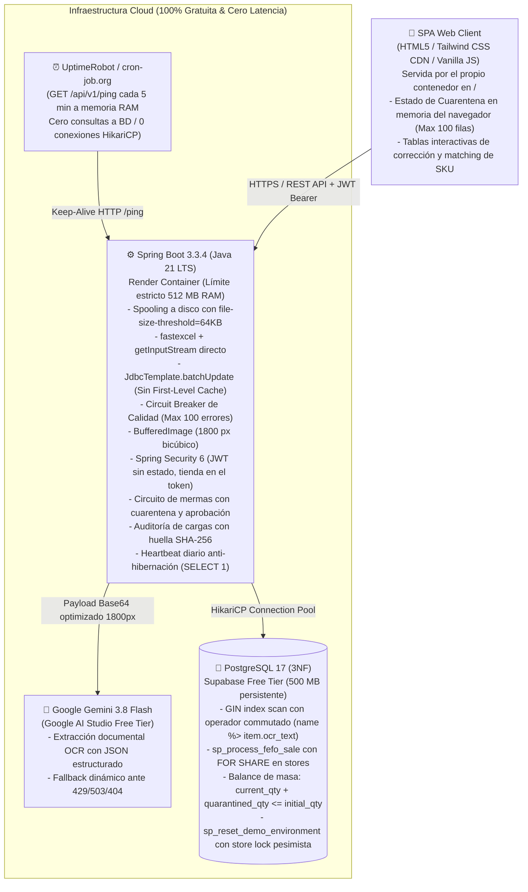
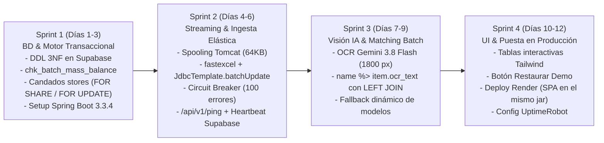

# 📋 Informe de Arquitectura Técnica: Kardo (v2.4)
## Plataforma SaaS B2B de Migración Inteligente, Conciliación Documental con Visión IA y Motor Transaccional FEFO (3NF)

---

### 1. Resumen Ejecutivo y Storytelling de Negocio
**Kardo** es una plataforma SaaS B2B diseñada para erradicar las ineficiencias críticas de inventario, los descuadres de recepción documental y las pérdidas por vencimiento en cadenas de retail de alta frecuencia, minimarkets y farmacias.

* **El Problema:** El 90% de los negocios de proximidad gestiona su stock en hojas de cálculo heterogéneas y transcribe manualmente facturas y guías de remisión impresas. Esto genera que más del 70% de las mermas monetarias se deban al vencimiento de perecibles (por falla en la rotación FEFO/PEPS) y a discrepancias no reclamadas frente al proveedor.
* **La Solución:** Un SaaS que ingesta archivos Excel masivos en streaming continuo (< 20 MB de RAM), procesa guías de remisión impresas mediante Visión Multimodal (Gemini 3.8 Flash) cruzándolas contra el catálogo relacional en 3NF, y ejecuta las salidas bajo estricto algoritmo transaccional FEFO con auditoría antifraude en PostgreSQL 17.

---

### 2. Diagrama de Arquitectura y Pila Tecnológica ($0 Costo / Producción 24/7)



#### Decisiones de Ingeniería Justificadas:
| Componente | Tecnología | Decisión de Arquitectura / Trade-off |
|---|---|---|
| **Core Runtime** | **Java 21 LTS + Spring Boot 3.3.4** | Tipado fuerte, Virtual Threads para concurrencia I/O y estándar corporativo bancario. |
| **Parser de Excel** | **`fastexcel` (dhatim) + `JdbcTemplate`** | **Evita OOM:** Streaming directo desde `file.getInputStream()` con spooling en `/tmp` fuera del Java Heap (`file-size-threshold=64KB`). Inserta mediante `JdbcTemplate.batchUpdate()` en micro-lotes de 500 filas, esquivando el First-Level Cache de Hibernate. |
| **Persistencia** | **PostgreSQL 17 en Supabase** | 500 MB persistentes que no consumen horas de cómputo activo como Neon, con índice `GIN` para `word_similarity` y procedimientos transaccionales. |
| **Keep-Alive Híbrido** | **UptimeRobot (5 min) + Heartbeat diario** | `/api/v1/ping` en RAM cada 5 min mantiene vivo Render; un `@Scheduled` diario ejecuta `SELECT 1` para evitar la pausa por 7 días de inactividad de Supabase. |
| **IA & OCR** | **Gemini 3.8 Flash (1800 px bicúbico)** | Preserva la legibilidad de letras pequeñas en facturas A4 produciendo un payload ligero (~350 KB) con autodescubrimiento y conmutación de modelos. |
| **Identidad** | **Spring Security 6 + JWT HS256 + BCrypt** | La tienda es un atributo del usuario y viaja firmada dentro del token: ningún endpoint acepta un `store_id` del cliente. Roles OPERATOR y MANAGER aplicados con `@PreAuthorize`. |
| **Entrega de la SPA** | **Recursos estáticos del propio jar** | Un único despliegue en Render en lugar de backend y frontend separados: desaparecen el CORS entre dominios, el segundo pipeline y la ventana en que una versión del front habla con otra del back. |
| **Idempotencia de cargas** | **SHA-256 del contenido + índice único parcial** | Reintentar una carga tras un corte de red es el error más común del operario; la huella del contenido lo detecta aunque el archivo llegue renombrado. |

---

### 3. Blindaje Quirúrgico de los Retos de Arquitectura

#### 🛠️ Reto 1: Control Antifraude e Invariante de Masa Físico (`chk_batch_mass_balance`)
* **Problema:** Mover unidades de `current_qty` a `quarantined_qty` sin actualizar la restricción de integridad permite que, ante fallos de concurrencia o dobles rechazos, el inventario supere el lote original (`initial_qty`).
* **Solución Arquitectónica (Restricción de Masa e Integridad):**
  * La definición DDL de `inventory_batches` incorpora el invariante estricto:
    ```sql
    CONSTRAINT chk_batch_mass_balance 
    CHECK (current_qty >= 0 AND quarantined_qty >= 0 AND (current_qty + quarantined_qty) <= initial_qty);
    ```
  * **Transacción Atómica con Guarda:**
    ```sql
    UPDATE inventory_batches 
    SET current_qty = current_qty - :discarded_qty,
        quarantined_qty = quarantined_qty + :discarded_qty,
        batch_status = CASE 
            WHEN (current_qty - :discarded_qty) = 0 THEN 'DEPLETED' 
            ELSE batch_status 
        END
    WHERE batch_id = :batch_id 
      AND current_qty >= :discarded_qty;
    ```
  * **Resolución del Manager:**
    * **Si el Manager APRUEBA (`APPROVED`):** Se ejecuta `quarantined_qty = quarantined_qty - :discarded_qty` consolidando la merma contable.
    * **Si el Manager RECHAZA (`REJECTED`):** Se revierte a `current_qty = current_qty + :discarded_qty` y, si `expiration_date >= CURRENT_DATE`, se reactiva `batch_status = 'ACTIVE'`.

#### 🛠️ Reto 2: Resolución Óptima de OCR Documental
* **Problema:** Reescalar una factura A4 con texto denso a `< 1024 px` degrada caracteres alfanuméricos (`8` vs `0`, `B` vs `6`), induciendo alucinaciones en la IA.
* **Solución Arquitectónica:**
  * El módulo `ImageProcessingService` fija el lado mayor en **`1800 px`** con interpolación bicúbica (`RenderingHints.VALUE_INTERPOLATION_BICUBIC`) y compresión JPEG al 85%.
  * Garantiza nitidez para fuentes de hasta 6 pt en un payload optimizado de ~350 KB transmitido en ~1.1 s a Gemini.

#### 🛠️ Reto 3: Ingesta Streaming Zero-Server-State y Circuit Breaker de Calidad
* **Problema:** Cargar archivos grandes en RAM o tolerar archivos con miles de filas erróneas colapsa la memoria del servidor de 512 MB y congela el DOM del navegador.
* **Solución Arquitectónica:**
  1. **Configuración de Spooling de Tomcat:**
     ```properties
     spring.servlet.multipart.file-size-threshold=64KB
     spring.servlet.multipart.max-file-size=10MB
     ```
     Tomcat escribe a `/tmp` fuera del Java Heap; `fastexcel` lee el flujo directamente vía `file.getInputStream()`.
  2. **Persistencia Directa:** Se inserta mediante `JdbcTemplate.batchUpdate()` en micro-lotes de 500 filas sin First-Level Cache de Hibernate.
  3. **Circuit Breaker de Calidad:** Si el archivo supera las **100 filas corruptas**, el streaming aborta inmediatamente con HTTP 422: *"Estructura de archivo corrupta o plantilla no compatible"*.
  4. Los errores menores a 100 se devuelven en el JSON HTTP y se corrigen en la memoria del navegador del cliente (JS), enviando un `POST /bulk-fix` únicamente con las filas modificadas. **0 bytes de estado en el heap del servidor**.

#### 🛠️ Reto 4: Entity Matching de SKUs con Índice GIN (`Bitmap Index Scan`) sin N+1
* **Problema:** En la factura dice `"CERV PILSEN 650"` y en BD `"Cerveza Pilsen Callao Botella 650ml"`. Si el operando indexado no está en la posición adecuada, PostgreSQL descarta el índice GIN e incurre en un escaneo secuencial (*Seq Scan*). Además, un `CROSS JOIN` pierde los productos nuevos.
* **Solución Arquitectónica:**
  1. Se crea el índice GIN en PostgreSQL:
     ```sql
     CREATE INDEX idx_products_name_trgm ON products USING gin (name gin_trgm_ops);
     ```
  2. Se conmuta el operador colocando la columna indexada (`name`) a la izquierda (`name %> item.ocr_text`) para forzar el uso del índice GIN, utilizando arreglos paralelos tipados y `LEFT JOIN LATERAL`:
     ```sql
     SELECT item.ocr_line_id, p.product_id, p.name, 
            word_similarity(item.ocr_text, p.name) AS score
     FROM UNNEST(:line_ids::int[], :ocr_texts::text[]) AS item(ocr_line_id, ocr_text)
     LEFT JOIN LATERAL (
         SELECT product_id, name 
         FROM products 
         WHERE name %> item.ocr_text
         ORDER BY word_similarity(item.ocr_text, name) DESC 
         LIMIT 1
     ) p ON TRUE;
     ```
  3. En 1 solo viaje de red (*round-trip*) se resuelven todos los ítems de la guía. Si el producto es nuevo, `p.product_id` retorna `NULL` y la interfaz web solicita al operario vincularlo o crear un nuevo SKU.
  4. **Alineación del umbral de trigramas (verificado en producción):** el operador `%>` no compara contra el umbral de la aplicación sino contra el GUC `pg_trgm.word_similarity_threshold`, cuyo valor de fábrica es **0.6**. El caso insignia de este documento, `"CERV PILSEN 650"` frente a `"Cerveza Pilsen Callao Botella 650ml"`, tiene una similitud real de **0.550**: con el umbral por defecto la línea se descartaba en el `WHERE` y llegaba como producto nuevo aunque el catálogo sí lo tuviera. El repositorio alinea el GUC con `kardo.matching.min-score` dentro de la transacción de lectura:
     ```sql
     SELECT set_config('pg_trgm.word_similarity_threshold', :min_score, true);
     ```
     El `is_local => true` evita contaminar otras sesiones del pool de HikariCP.
  5. **Evidencia del plan de ejecución** (medida con `EXPLAIN` sobre la base real):
     ```
     name %> 'CERV PILSEN 650'   ->  Bitmap Index Scan on idx_products_name_trgm
     'CERV PILSEN 650' %> name   ->  Seq Scan (ni siquiera con enable_seqscan=off)
     ```
     Confirma que el orden de los operandos es lo que decide el uso del índice GIN.

#### 🛠️ Reto 5: Estrategia Híbrida 24/7 (Cero Latencia en Render + Cero Hibernación en Supabase)
* **Problema:** Mantener despierto Render mediante `/ping` en memoria no previene que Supabase pause la base de datos tras 7 días sin consultas SQL.
* **Solución Arquitectónica:**
  * **Capa 1 (Render despierto):** **UptimeRobot** emite un `GET /api/v1/ping` cada 5 minutos exactos hacia un endpoint en memoria (`ResponseEntity.ok("pong")`), garantizando que la JVM no se duerma.
  * **Capa 2 (Supabase activo):** Un componente `@Scheduled(cron = "0 0 12 * * ?")` dentro de Spring Boot ejecuta un `SELECT 1` al mediodía (1 consulta al día). Esto mantiene activo el proyecto de Supabase sin consumir cuotas de cómputo innecesarias.

#### 🛠️ Reto 6: Concurrencia e Idempotencia en el Escenario Demo (Bloqueo Jerárquico en `stores`)
* **Problema:** `sp_reset_demo_environment()` borra tablas hijas, pero transacciones de venta simultáneas (`sp_process_fefo_sale`) pueden operar en paralelo si no existe un candado jerárquico común.
* **Solución Arquitectónica:**
  * **Candado en la Venta (`sp_process_fefo_sale`):** En la primera línea del procedimiento de venta se adquiere un bloqueo compartido:
    ```sql
    PERFORM 1 FROM stores WHERE store_id = p_store_id FOR SHARE;
    ```
  * **Candado Exclusivo en el Reset Demo (`sp_reset_demo_environment`):**
    ```sql
    CREATE OR REPLACE PROCEDURE sp_reset_demo_environment()
    LANGUAGE plpgsql AS $$
    BEGIN
        -- Candado exclusivo sobre la tienda demo: espera a que terminen ventas en vuelo
        -- y bloquea nuevas ventas hasta concluir la reinicialización
        PERFORM store_id FROM stores WHERE store_id = 999 FOR UPDATE;
        
        -- Borrado en orden estricto de dependencias foráneas
        DELETE FROM daily_sales WHERE store_id = 999;
        DELETE FROM waste_log WHERE store_id = 999;
        DELETE FROM inventory_batches WHERE store_id = 999;
        DELETE FROM goods_receipt_items WHERE receipt_id IN (
            SELECT receipt_id FROM goods_receipt_headers WHERE store_id = 999
        );
        DELETE FROM goods_receipt_headers WHERE store_id = 999;
        
        -- Siembra determinista de 25 productos, 2 guías y 5 lotes por vencer (< 48h)
        INSERT INTO goods_receipt_headers (...) VALUES (...);
        INSERT INTO inventory_batches (...) VALUES (...);
    END;
    $$;
    ```
  * Garantiza ejecución determinista en < 200 ms sin violaciones de integridad ni deadlocks.
  * **Añadido tras implementarlo:** el procedimiento no borra `inventory_uploads`. Sin limpiarlas, tras restaurar la demo el evaluador no podía volver a subir el mismo Excel —la huella seguía vigente y la carga se rechazaba por duplicada aunque sus lotes ya no existieran—, así que `DemoRepository` elimina las huellas de la tienda 999 junto con el resto del escenario.

#### 🛠️ Reto 7: Aislamiento entre Tiendas (la tienda la decide el token, no la petición)
* **Problema:** los endpoints recibían `store_id` como parámetro del cliente (`?store_id=999`) y nadie lo contrastaba contra el token. Un operario autenticado podía cargar inventario, escanear guías o confirmar recepciones **en una tienda ajena cambiando un número en la URL**. Cualquier auditoría construida sobre eso habría registrado al autor correcto de una escritura que no debía existir.
* **Solución Arquitectónica:**
  * La tienda pasa a ser un atributo del usuario (`users.store_id`) y viaja firmada en el claim `storeId`. `KardoPrincipal` la transporta y `StoreScope.current()` es el **único** origen del `store_id` en los controladores.
  * Cuando el cuerpo de la petición incluye `storeId` por contrato con la SPA, se compara con el del token y se responde **403** si difieren: callarlo convertiría un intento de salto entre inquilinos en una escritura silenciosa sobre la tienda equivocada.
  * Un token sin `storeId` no autentica: nadie opera sin tienda asignada.
  * El login responde lo mismo ante contraseña incorrecta y correo inexistente, para no permitir enumerar los correos dados de alta.
* **Efecto secundario detectado al probarlo:** con la cadena de seguridad endurecida, cualquier error dentro de un endpoint protegido se respondía como **401** en lugar de su código real, porque el reenvío interno a `/error` volvía a pasar por la cadena. Se permite explícitamente el despacho `ERROR`.

#### 🛠️ Reto 8: Segregación de Funciones en Mermas (cierre del Reto 1)
* **Problema:** el esquema traía `quarantined_qty`, `chk_batch_mass_balance` y `waste_log.approval_status`, pero ningún endpoint los usaba. El invariante existía sin circuito que lo ejercitara.
* **Solución Arquitectónica:**
  * `sp_report_waste` mueve unidades de `current_qty` a `quarantined_qty` con la guarda `AND current_qty >= p_quantity`: dos operarios declarando mermas del mismo lote a la vez no pueden pasarse del stock porque el segundo `UPDATE` no encuentra fila que cumplir.
  * `sp_approve_waste` consolida la pérdida; `sp_reject_waste` devuelve la mercadería y reactiva el lote, o lo marca `EXPIRED` si venció entretanto.
  * Ambas resoluciones bloquean la fila de merma con `FOR UPDATE`, lo que las hace **idempotentes**: dos clics del gerente no la aplican dos veces.
  * **Quien declara no puede aprobar:** declarar admite OPERATOR y MANAGER; resolver exige `hasRole('MANAGER')`.
* **Límite conocido:** el control es por rol, no por persona. Un gerente puede declarar y aprobar su propia merma; separar también por usuario es el siguiente paso si se quiere segregación estricta.

#### 🛠️ Reto 9: Auditoría e Idempotencia por Contenido
* **Problema:** una carga de Excel no dejaba rastro de quién la hizo, y **subir dos veces el mismo archivo duplicaba los lotes en silencio**. Con conexiones inestables, reintentar una carga que sí llegó es el error más común del operario.
* **Solución Arquitectónica:**
  * `inventory_uploads` registra operario, archivo, tamaño, métricas, IP y momento exacto; `goods_receipt_headers` gana `confirmed_by`, porque la conciliación es una decisión humana sobre qué entró de verdad al almacén.
  * La huella es el **SHA-256 del contenido**, calculada en streaming: renombrar el archivo no esquiva el rechazo.
  * El archivo se recorre dos veces —huella e ingesta—. Es barato porque Tomcat ya lo dejó en disco, y permite rechazar una recarga en milisegundos en lugar de tras procesar 10 MB.
  * El asiento se abre **antes** de ingerir, dentro de la misma transacción: si dos peticiones idénticas entran a la vez, el índice único hace fallar a la segunda antes de que haga trabajo.

#### 🛠️ Reto 10: Reversión por Deltas, no por Snapshots
* **Problema:** guardar una foto del inventario por cada carga multiplicaría los datos sin aportar nada y se comería los 500 MB del plan gratuito.
* **Solución Arquitectónica:**
  * Cada lote lleva el `upload_id` que lo creó: el "snapshot" es una consulta, no una copia.
  * **Revertir no es borrar lo que la carga escribió, es borrarlo solo si nadie lo ha usado.** Un lote del que ya se vendió o del que se declaró una merma es historia real del almacén; eliminarlo dejaría ventas apuntando a un lote inexistente. La reversión es **todo o nada** y nombra el lote que la bloquea.
  * El catálogo no se toca: un SKU creado por la carga puede tener ya otros lotes de una recepción posterior.
  * La unicidad de la huella es **parcial** (`WHERE rolled_back_at IS NULL`): el flujo natural tras un error es revertir y volver a subir, y una unicidad total dejaría al gerente atascado.

---

### 4. Roadmap de Desarrollo (2 Semanas / 4 Sprints con Tailwind CSS)



---

### 5. Checklist Operativo y Parámetros de Configuración de Producción

Para garantizar una integración fluida entre Render y Supabase, se definen los parámetros exactos de infraestructura:

#### 1. Configuración de Red, CORS y Puerto Dinámico (`application.properties`)
* **Puerto Dinámico en Render:**
  ```properties
  server.port=${PORT:8080}
  ```
* **CORS:** la SPA se sirve desde el mismo contenedor (`/`), así que en el despliegue actual no hay petición entre dominios. El bean `CorsConfigurationSource` sigue configurado vía `CORS_ALLOWED_ORIGINS` para el caso de un front separado, con `setAllowCredentials(true)` y cabeceras expuestas `Authorization` y `Content-Type`.
* **Rutas públicas:** `GET /api/v1/ping`, los estáticos de la SPA, `POST /api/v1/auth/login` y `POST /api/v1/demo/reset` —la puerta de entrada del evaluador, que solo puede tocar la tienda 999—. Todo lo demás exige token.
* **Secretos obligatorios:** `DATABASE_URL`, `DATABASE_USERNAME`, `DATABASE_PASSWORD`, `JWT_SECRET` (mínimo 32 bytes; `JwtService` rechaza el arranque si falta o es corto, porque Spring entrega el literal `${JWT_SECRET}` y jjwt fallaría con un error sobre bits que no dice qué configurar) y `GEMINI_API_KEY`.
* **Auditoría tras proxy:** `server.forward-headers-strategy=framework`, o se registraría siempre la IP del proxy de Render en lugar de la del operario.

#### 2. Conectividad y Pool HikariCP para Supabase Free Tier
* **Versión del motor:** Supabase provisiona hoy **PostgreSQL 17** (verificado: `17.11`). El DDL en 3NF, los procedimientos y el índice GIN funcionan sin cambios; la referencia a la 15 del diseño original queda superada.
* **Activación DDL Manual en Supabase:**
  ```sql
  CREATE EXTENSION IF NOT EXISTS pg_trgm;
  ```
* **Advertencia sobre `sql/01_schema_ddl_3nf.sql`:** comienza con `DROP TABLE ... CASCADE`. Solo debe ejecutarse para inicializar un proyecto vacío; sobre una base con datos los destruye.
* **Orden de los scripts** (del 03 en adelante son aditivos e idempotentes, seguros de reejecutar):

  | Script | Qué aporta |
  |---|---|
  | `01_schema_ddl_3nf.sql` | Esquema 3NF, invariantes e índices. **Destructivo** |
  | `02_procedures_and_triggers.sql` | FEFO, reset demo |
  | `03_users_and_auth.sql` | Tabla `users` y los dos usuarios de la tienda demo |
  | `04_fefo_sale_hardening.sql` | Corrige `sp_process_fefo_sale` (compañía, tienda, cantidad) |
  | `05_waste_workflow.sql` | `sp_report_waste`, `sp_approve_waste`, `sp_reject_waste` |
  | `06_upload_audit.sql` | `inventory_uploads`, `confirmed_by` en las guías |
  | `07_upload_rollback.sql` | `upload_id` en los lotes, unicidad parcial de la huella |
* **Dialecto fijado en el arranque:** `JdbcConfig` declara el dialecto PostgreSQL en lugar de dejar que Spring Data JDBC lo deduzca abriendo una conexión durante el refresco del contexto. Sin eso, una base pausada o una red caída impiden que el contenedor levante y, por tanto, que responda `/api/v1/ping`, que es justo el endpoint encargado de mantenerlo vivo.
* **Límite de Conexiones HikariCP (evita saturación en capa gratuita):**
  ```properties
  spring.datasource.hikari.maximum-pool-size=5
  spring.datasource.hikari.minimum-idle=2
  spring.datasource.hikari.connection-timeout=30000
  ```

#### 3. Timeouts y Conexión para Gemini 3.8 Flash
* **Timeouts de Lectura y Conexión:** Configuración del cliente HTTP (`RestClient`) con **20 segundos** de lectura para absorber picos de tráfico en la API de Google sin lanzar `SocketTimeoutException`.
* **Seguridad de Secretos:** `GEMINI_API_KEY` inyectada en las variables de entorno cifradas de Render y enviada en la cabecera `x-goog-api-key`, nunca como parámetro de la URL (no debe quedar en logs de acceso ni en historiales de proxy).
* **Cadena de modelos:**
  ```properties
  kardo.gemini.model=gemini-3.8-flash
  kardo.gemini.fallback-models=gemini-3.5-flash,gemini-2.5-flash
  kardo.gemini.max-attempts=3
  ```
* **Conmutación de modelo ante 429 / 503 / 404:** además de la cuota agotada (429) y la sobrecarga (503), se conmuta ante **404**. Google retira modelos antiguos y responde `"This model is no longer available"`; tratarlo como error definitivo dejaría la recepción de mercadería caída hasta un redespliegue. Los `400`, `401` y `403` sí son definitivos: reintentar con otro modelo no los arregla y consume cuota.
* **Nota de vigencia:** `gemini-2.0-flash`, el modelo original de este documento, fue retirado por Google y hoy devuelve `404`. Conviene revisar `GET /v1beta/models` antes de cada despliegue mayor.

#### 4. Spooling de Tomcat para Archivos Multiparte
* **Protección del Heap de 512 MB:**
  ```properties
  spring.servlet.multipart.enabled=true
  spring.servlet.multipart.file-size-threshold=64KB
  spring.servlet.multipart.max-file-size=10MB
  spring.servlet.multipart.max-request-size=10MB
  ```

#### 5. Manejo Centralizado de Excepciones (`@RestControllerAdvice`)
* `InsufficientStockException` ➔ HTTP 409 (Conflict).
* `MaxUploadSizeExceededException` ➔ HTTP 400 (Bad Request).
* Circuit Breaker (> 100 filas erróneas en Excel) ➔ HTTP 422 (Unprocessable Entity).
* `InvalidCredentialsException` ➔ 401 · `ForbiddenStoreException` y `AccessDeniedException` ➔ 403 (el detalle queda en el log, no en la respuesta).
* `GeminiUnavailableException` ➔ 503 · `GeminiExtractionException` ➔ 502 (el fallo es de un servicio aguas arriba, no del cliente).
* `DuplicateUploadException` ➔ 409 nombrando quién subió el archivo y cuándo · `UploadNotRevertibleException` ➔ 409 con la lista de lotes que bloquean.
* Los `ERRCODE` de los procedimientos (`P0001`–`P0007`) se traducen en `FefoSaleErrorTranslator` y `WasteService`, de modo que una regla de negocio escrita en PL/pgSQL llega al operario como 404, 409 o 400 y no como un 500 opaco.

#### 6. Superficie de API
| Método | Endpoint | Acceso |
|---|---|---|
| `GET` | `/api/v1/ping` | Público, sin tocar la BD |
| `POST` | `/api/v1/auth/login` · `GET /api/v1/auth/me` | Público / autenticado |
| `POST` | `/api/v1/demo/reset` | Público (solo tienda 999) |
| `GET` | `/api/v1/demo/dashboard` · `/demo/fefo-queue` | Autenticado |
| `POST` | `/api/v1/inventory/ingest/excel` · `/bulk-fix` | OPERATOR o MANAGER |
| `GET` | `/api/v1/inventory/ingest/history` | OPERATOR o MANAGER |
| `POST` | `/api/v1/inventory/ingest/{id}/rollback` | **MANAGER** |
| `GET` | `/api/v1/inventory/export` | OPERATOR o MANAGER |
| `POST` | `/api/v1/inventory/sales` | OPERATOR o MANAGER |
| `POST` | `/api/v1/inventory/waste` · `GET` lista | OPERATOR o MANAGER |
| `POST` | `/api/v1/inventory/waste/{id}/approve` · `/reject` | **MANAGER** |
| `POST` | `/api/v1/receipts/scan` · `/confirm` | OPERATOR o MANAGER |
| `GET` | `/api/v1/products` | Autenticado (catálogo de su compañía) |

---

### 6. Resumen del Perfil Competitivo Frente a Evaluadores Técnicos
Este proyecto te posiciona como un candidato sobresaliente para el **BCP / Interbank** porque demuestra:
1. **Control Fino de Recursos en la Nube:** Sabes diseñar sistemas que operan de forma estable dentro de límites reales de memoria (512 MB de RAM) usando streaming, spooling en disco y `JdbcTemplate`.
2. **Dominio Transaccional Avanzado:** Previenes condiciones de carrera en mermas con reservas preventivas (`quarantined_qty`), blindas el balance de masa con `chk_batch_mass_balance` y sincronizas candados jerárquicos entre `stores` y sus tablas hijas (`FOR SHARE` vs `FOR UPDATE`).
3. **Ingeniería de Consultas SQL:** Optimizas matching de texto informal forzando el índice `GIN` con `name %> item.ocr_text` y arreglos paralelos con `UNNEST` y `LEFT JOIN LATERAL`, eliminando problemas de latencia `N+1` y previniendo la pérdida silenciosa de productos nuevos.
4. **Resiliencia Operativa:** Aplicas Circuit Breakers para proteger la memoria frente a archivos corruptos y orquestas disponibilidad 24/7 híbrida contra la hibernación de servicios gratuitos.

---

### 7. Verificación Contra Infraestructura Real (18/10/2026)

Las decisiones de este documento se contrastaron contra el proyecto Supabase real
y la API de Google AI Studio. Resultados y ajustes derivados:

| Área | Hallazgo | Ajuste aplicado |
|---|---|---|
| Motor de BD | Supabase provisiona PostgreSQL **17.11**, no 15 | Referencias actualizadas; sin cambios en DDL ni procedimientos |
| Matching GIN | `name %> texto` → `Bitmap Index Scan`; invertido → `Seq Scan` | Confirma el orden de operandos del Reto 4 |
| Umbral de trigramas | `%>` usa el GUC de 0.6; `"CERV PILSEN 650"` puntúa 0.550 y se descartaba | `set_config('pg_trgm.word_similarity_threshold', min_score, true)` por transacción |
| Modelos de Gemini | `gemini-2.0-flash` retirado (`404 NOT_FOUND`) | Cadena `gemini-3.8-flash` → `3.5-flash` → `2.5-flash`; el `404` conmuta de modelo |
| Extracción documental | Guía de 5 líneas leída con RUC, número, fecha, lotes y vencimientos correctos | — |
| Alucinaciones | Ante una foto que no es un documento, el modelo devuelve campos nulos y cero ítems | El prompt prohíbe inventar valores |
| Secretos | La configuración local en `src/main/resources` viajaba dentro del jar | Movida a `./config/`, excluida del empaquetado y de Git |
| `JWT_SECRET` ausente | Spring entrega el literal `${JWT_SECRET}` (13 bytes) y jjwt falla con un error sobre bits | `JwtService` valida el secreto y nombra la variable que falta |
| Comentarios SQL | Ambos archivos de `sql/` abrían con `#`, inválido en PostgreSQL | Convertidos a `--` |

Cobertura automatizada: **33 pruebas** (streaming de Excel, compuerta de calidad,
Circuit Breaker, JWT, procesamiento de imagen, cliente de Gemini con sus
conmutaciones y conciliación documental).

---

### 8. Segunda Ronda de Endurecimiento (19/10/2026)

| Área | Hallazgo | Ajuste aplicado |
|---|---|---|
| Multi-tenant | `store_id` llegaba como parámetro del cliente y nadie lo contrastaba con el token | La tienda sale del token; un `storeId` ajeno responde 403 y queda en el log con el correo |
| Autenticación | `/api/v1/auth/**` estaba abierto pero no existía ningún controlador detrás | Tabla `users`, login con BCrypt y `@PreAuthorize` real sobre las escrituras |
| Cadena de filtros | Cualquier error dentro de un endpoint protegido se respondía como 401 | Se permite el despacho `ERROR`; una carga sin archivo vuelve a dar 415 |
| `sp_process_fefo_sale` | Resolvía el producto **sin filtrar por compañía** (el mismo SKU en dos clientes descontaba del equivocado) | Filtro por la compañía de la tienda; verificado creando una segunda compañía con el mismo SKU |
| `sp_process_fefo_sale` | Tienda inexistente llegaba hasta una violación de clave foránea; vender 0 o −5 terminaba sin error y sin registrar nada | `P0003` y `P0004` con mensajes explícitos |
| Mermas | El invariante de masa existía sin circuito que lo ejercitara | Tres procedimientos, cuarentena preventiva y aprobación solo del gerente |
| Cargas | Subir dos veces el mismo archivo duplicaba los lotes en silencio | Huella SHA-256 con índice único parcial; renombrar no la esquiva |
| Reset demo | No limpiaba las huellas, así que tras restaurar no se podía recargar el mismo Excel | `DemoRepository` las elimina con el resto del escenario |
| Reversión | — | Por deltas (`upload_id` en el lote), todo o nada, sin tocar el catálogo |

**Despliegue verificado** en `https://kardo.onrender.com`: `/api/v1/ping` responde
`pong` en ~0.2 s, la SPA sirve los paneles de mermas, auditoría y exportación, el
login real devuelve la sesión del gerente demo, la exportación entrega el `.xlsx`
y todos los endpoints protegidos responden 401 sin token.

Cobertura automatizada tras esta ronda: **68 pruebas**.

> **Pendiente conocido:** no hay pruebas de integración contra una base real —todo
> el SQL interesante (el `UNNEST` con `%>`, el `set_config` del umbral, los
> procedimientos FEFO y de mermas, el invariante de masa) se verificó a mano
> contra Supabase. Un PostgreSQL efímero con Testcontainers ejecutando el DDL en
> cada build es el siguiente paso natural para un proyecto que se presenta como
> de nivel bancario.
